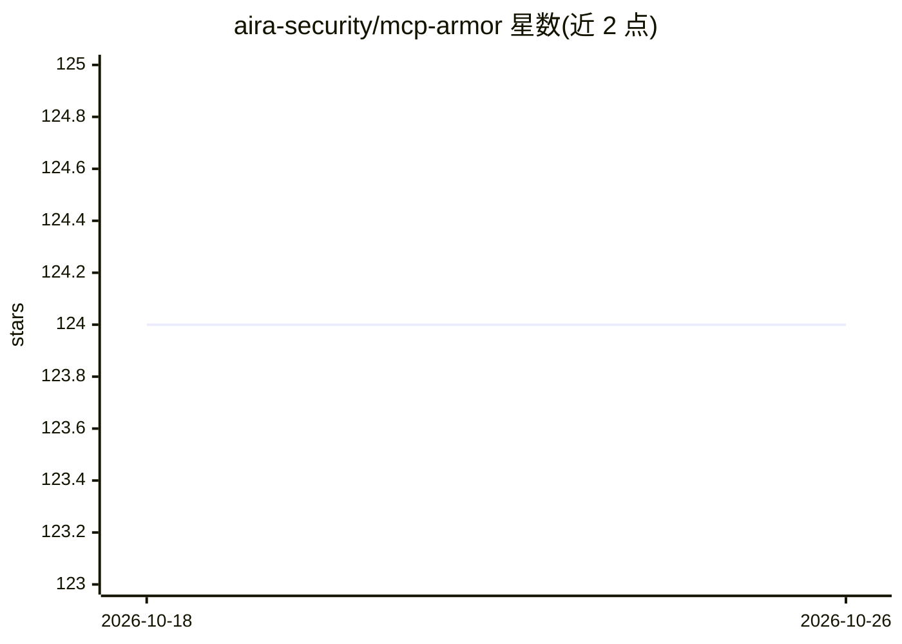

# aira-security/mcp-armor

⭐ 124 · Python · Apache-2.0 · 推送 2026-03-27 · [GitHub](https://github.com/aira-security/mcp-armor) · [官网](https://airasecurity.ai) · 组织维护

**MCP 服务器安全扫描器：检测 agent 工具通信中的注入与投毒风险**

面向 Model Context Protocol 的安全扫描工具：自动发现 Cursor、Windsurf、VS Code、Claude Desktop 等 IDE/客户端已集成的 MCP 配置，连接服务器盘点工具、资源与提示模板，执行提示注入、工具投毒、跨服务器工具遮蔽、命令注入、硬编码密钥等静态检查，并支持基线漂移检测（Rug Pull 攻击）。输出 JSON/Markdown 报告与带时间戳的审计记录，全程本地运行，提示注入检测使用 Hugging Face 上的开源模型 FT-Llama-Prompt-Guard-2。开源版仅覆盖静态配置扫描，运行时拦截与策略执行等能力在 Aira 商业平台中提供。

## 筛选速览

| 维度 | 判定 | 备注 |
|---|---|---|
| AI 角色 | `ai-ecosystem` | LLM/agent 周边工具 |
| 许可风险 | `permissive` | Apache-2.0 |
| 部署形态 | `library` | 以包/库形式分发 |
| 模型依赖 | — | README 未给出锁定关系 |
| 硬件要求 | — | 无带数字的原话,不猜 |
| 安装摩擦 | `low` | 无编译、无系统依赖或容器化 |
| 成熟度 | — | 结构信号不足 |

## 能力要点

- 自动发现主流 Agentic IDE/客户端的 MCP 配置并盘点工具/资源/提示
- 提示注入、命令注入、工具投毒、跨服务器工具遮蔽、硬编码密钥等安全检查
- 基线漂移检测（Tool/Resource/Prompt Modified 等 Rug Pull 场景）
- 生成 JSON/Markdown 报告与带时间戳的审计基线，全程本地运行

## 适用场景

- 上线前审计接入的 MCP 服务器是否存在提示注入或工具投毒
- 以基线方式追踪 MCP 工具/资源被篡改的 Rug Pull 变更
- 盘点各 IDE 中已集成的 MCP 配置与工具清单

## 场景标签

`网络安全` · 领域:学习与行业

## 证据(README 行号)

> L5: MCP Armor is a comprehensive security scanner for Model Context Protocol (MCP). Automatically discovers, analyzes, a
> L13: - **🛡️ Security Analysis**: Specialized security checks including Prompt Injection, Rug Pull Attack, Cross-server T

## 星数曲线

2026-10-18 124 → 2026-10-26 124（+0）

---
*卡片 v1 · prompt 1.4 · 生成 2026-10-23 · 置信度 high · 依据 README sha `288f4be59ee2` · [字段定义](../../DATASET.md)*
