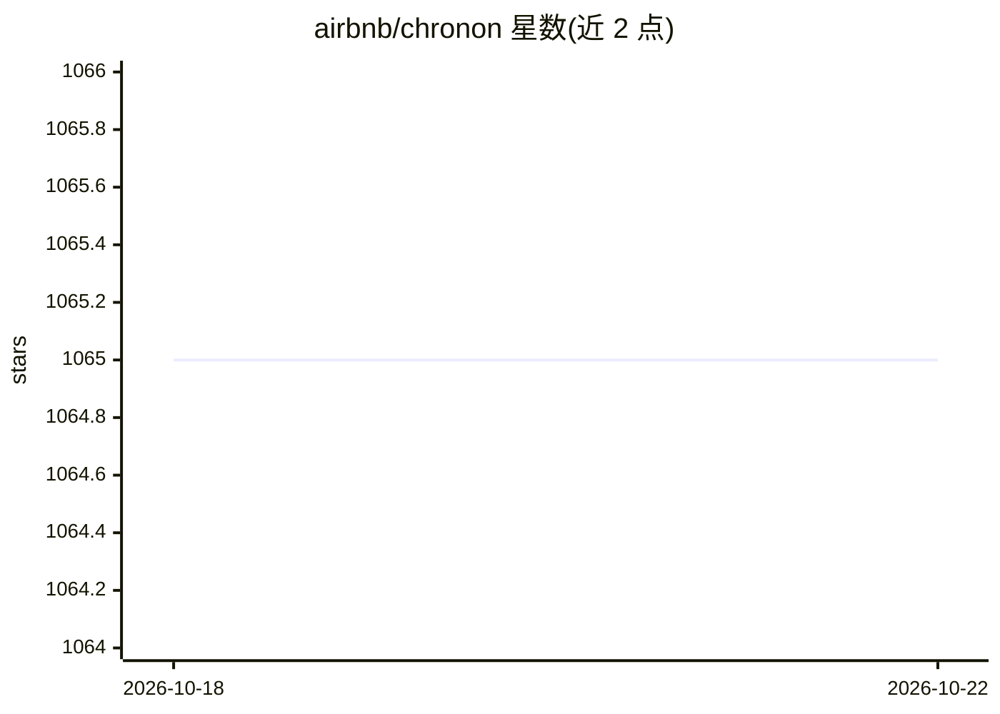

# airbnb/chronon

⭐ 1,065 · Scala · Apache-2.0 · 推送 2026-10-08 · [GitHub](https://github.com/airbnb/chronon) · 组织维护

**面向 AI/ML 的特征计算与服务数据平台**

Chronon 是 Airbnb 开源的 AI/ML 数据平台：用户以原始数据的变换定义特征，平台执行批处理与流式计算、可扩展回填、低延迟在线服务，并保证在线/离线一致性与时间点准确性。提供数据新鲜度与一致性监控。支持任意窗口聚合，批表、事件流、服务等多种数据源。通过 GroupBy 与 Join API 定义特征，快速上手依赖 Docker（docker-compose 一键启动，内含 Spark、Kafka、MongoDB），在线服务可用 Java 客户端嵌入业务服务。

## 筛选速览

| 维度 | 判定 | 备注 |
|---|---|---|
| AI 角色 | `ai-ecosystem` | LLM/agent 周边工具 |
| 许可风险 | `permissive` | Apache-2.0 |
| 部署形态 | `self-host` | docker 或自建部署 |
| 模型依赖 | — | README 未给出锁定关系 |
| 硬件要求 | — | 无带数字的原话,不猜 |
| 安装摩擦 | `low` | 无编译、无系统依赖或容器化 |
| 成熟度 | — | 结构信号不足 |

## 能力要点

- 批流一体的特征计算与低延迟在线服务 API
- 点时间准确的大规模特征回填，保证训练与线上一致
- GroupBy/Join Python API 定义特征，compile.py/run.py 驱动计算
- 在线 KV 存储可对接自选数据库（示例用 MongoDB）

## 适用场景

- 为模型训练生成时间点准确的特征数据集
- 线上推理时实时获取特征向量（Java 客户端嵌入服务）
- 监控特征数据新鲜度与在线/离线一致性

## 场景标签

`MLOps` · 领域:训练与推理

## 证据(README 行号)

> L3: Chronon is a platform that abstracts away the complexity of data computation and serving for AI/ML applications. Use
> L15: Chronon offers an API for realtime fetching which returns up-to-date values for your features. It supports:

## 星数曲线

2026-10-18 1,065 → 2026-10-22 1,065（+0）

---
*卡片 v1 · prompt 1.4 · 生成 2026-10-21 · 置信度 high · 依据 README sha `b710a44fb397` · [字段定义](../../DATASET.md)*
