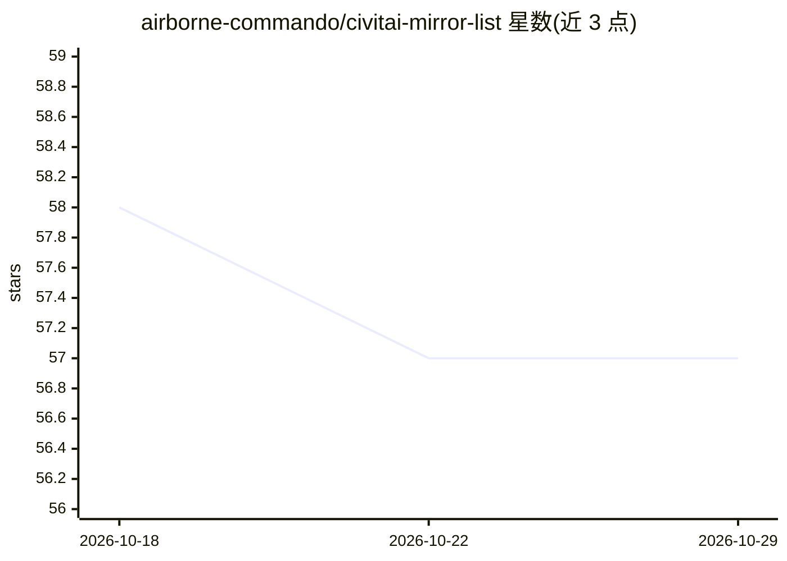

# airborne-commando/civitai-mirror-list

⭐ 57 · Unlicense · 推送 2026-01-27 · [GitHub](https://github.com/airborne-commando/civitai-mirror-list) · 个人维护 · 中文 README

**Civitai 替代站与被删模型镜像/归档资源清单**

一个建议清单形式的仓库：当 Civit.ai 上的模型被删除或站点不可用时，列举 Tensor.art、Hugging Face、ModelScope、SeaArt、civitaiarchive 等替代平台与社区归档，附带批量下载/归档工具（CivitAI-Model-grabber、go-civitai-downloader）、torrent 搜索引擎，以及保留 EXIF 元数据的图床对比表和 Kohya/Colab 本地训练指引。面向 Stable Diffusion 模型使用与收藏者，内容以链接汇总为主，不含可运行代码。

## 筛选速览

| 维度 | 判定 | 备注 |
|---|---|---|
| AI 角色 | `ai-knowledge` | 知识聚合/清单类 |
| 许可风险 | `permissive` | Unlicense |
| 部署形态 | `None` |  |
| 模型依赖 | — | README 未给出锁定关系 |
| 硬件要求 | — | 无带数字的原话,不猜 |
| 安装摩擦 | `low` | 无编译、无系统依赖或容器化 |
| 成熟度 | — | 结构信号不足 |

## 能力要点

- 列举 10+ 个 Civitai 替代平台与社区模型归档站
- 收录批量下载与归档工具（支持 torrent 生成）
- 对比 6 个保留 EXIF 元数据的图床
- 附 Kohya 本地（含 AMD）与 Colab 训练指引

## 适用场景

- 找回 Civitai 上已被删除或下架的模型和 LoRA
- 寻找 Civitai 之外的模型分享与归档平台
- 挑选不会剥离生成元数据的图片托管服务

## 场景标签

`精选清单` · 领域:学习与行业

## 证据(README 行号)

> L1: # Civit.ai mirror suggestion list
> L7: Sites similar to Civit.ai, which is a popular platform for sharing and discovering Stable Diffusion AI art models, i
> L16: * civitaiarchive.com A community-driven archive of models and files from Civit.ai; can look up models by model name

## 星数曲线

2026-10-18 58 → 2026-10-29 57（-1）

---
*卡片 v1 · prompt 1.4 · 生成 2026-10-24 · 置信度 high · 依据 README sha `8730a88a1efe` · [字段定义](../../DATASET.md)*
