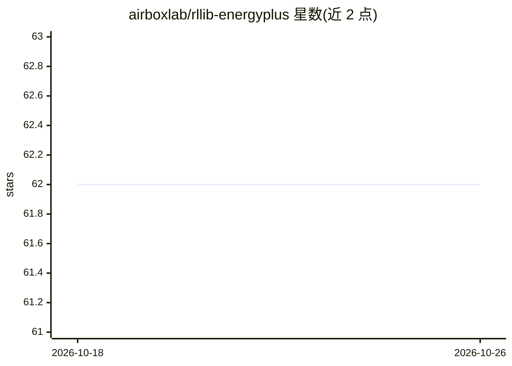

# airboxlab/rllib-energyplus

⭐ 62 · Python · MIT · 推送 2026-10-23 · [GitHub](https://github.com/airboxlab/rllib-energyplus) · 组织维护

**EnergyPlus 建筑模拟的 Gym 环境，用于强化学习控制优化**

基于 EnergyPlus Python API 封装的 Gym 环境，将建筑能耗仿真接入强化学习训练流程，并提供训练 RL 智能体的示例与工具。内置 Amphitheater 示例环境，可分别用 Ray RLlib 的 PPO 或 Meta Pearl 算法训练；用户可继承 EnergyPlusEnv 基类并实现抽象方法来创建新环境。依赖 Python 3.12 与 EnergyPlus 9.3+，默认包含 CPU 版 Torch，可选 GPU 版；提供 docker 镜像、Poetry 与 pip 三种安装方式，Tensorboard 用于实验跟踪。

## 筛选速览

| 维度 | 判定 | 备注 |
|---|---|---|
| AI 角色 | `ai-native` | 本体是模型或模型工具 |
| 许可风险 | `permissive` | MIT |
| 部署形态 | `self-host` | docker 或自建部署 |
| 模型依赖 | — | README 未给出锁定关系 |
| 硬件要求 | `cpu-ok` | |
| 安装摩擦 | `low` | 无编译、无系统依赖或容器化 |
| 成熟度 | — | 结构信号不足 |

## 能力要点

- Gym 接口封装 EnergyPlus 仿真，供 RL 训练调用
- 提供 Ray RLlib PPO 与 Meta Pearl 两种训练入口
- 可通过继承 EnergyPlusEnv 基类自定义新环境
- 依赖版本以 poetry.lock 锁定保证可复现

## 适用场景

- 用强化学习优化建筑能耗控制策略
- 在 EnergyPlus 仿真上训练与对比 PPO/Pearl 智能体
- 为自定义建筑模型构建 RL 训练环境

## 场景标签

`强化学习` · 领域:训练与推理

## 证据(README 行号)

> L5: This project implements a gym environment that handles EnergyPlus simulations
> L7: It also provides a set of examples and tools to train RL agents.

## 星数曲线

2026-10-18 62 → 2026-10-26 62（+0）

---
*卡片 v1 · prompt 1.4 · 生成 2026-10-24 · 置信度 high · 依据 README sha `0648b48e6a5e` · [字段定义](../../DATASET.md)*
