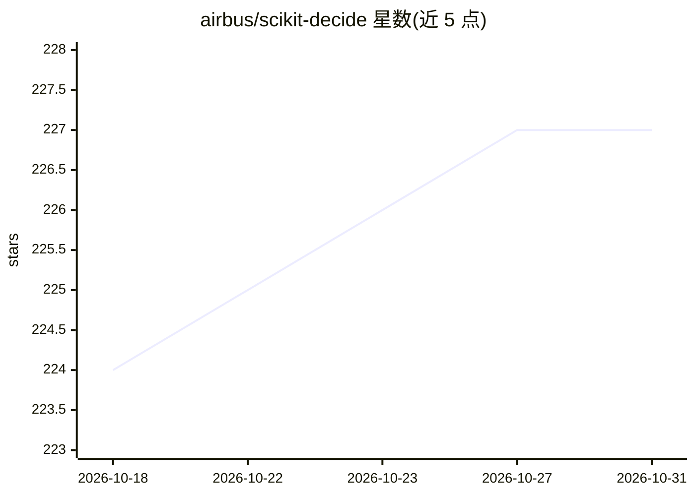

# airbus/scikit-decide

⭐ 227 · Python · MIT · 推送 2026-08-28 · [GitHub](https://github.com/airbus/scikit-decide) · [官网](https://airbus.github.io/scikit-decide) · 组织维护

**Airbus 开源的决策问题求解框架，覆盖 RL/规划/调度**

由 Airbus AI Research 发起的 Python 框架，用于强化学习、自动规划与调度问题：用户按统一接口描述决策问题一次，框架自动匹配兼容求解器。域覆盖 Gym(nasium)、PDDL、RDDL、飞行规划与调度等；求解器包括 ray.rllib 与 stable-baselines3 的 RL 算法、unified-planning 的规划器、内置搜索算法（A*、MCTS、RTDP 等）以及 discrete-optimization 封装的 ortools/gurobi 等，并支持基于 optuna 的超参调优。通过 pip 安装，附带 notebook 与示例脚本。

## 筛选速览

| 维度 | 判定 | 备注 |
|---|---|---|
| AI 角色 | `ai-ecosystem` | LLM/agent 周边工具 |
| 许可风险 | `permissive` | MIT |
| 部署形态 | `library` | 以包/库形式分发 |
| 模型依赖 | — | README 未给出锁定关系 |
| 硬件要求 | — | 无带数字的原话,不猜 |
| 安装摩擦 | `low` | 无编译、无系统依赖或容器化 |
| 成熟度 | — | 结构信号不足 |

## 能力要点

- 问题一次描述、自动匹配兼容求解器
- RL（ray.rllib/stable-baselines3）与规划（unified-planning）求解器目录
- 内置 A*/MCTS/RTDP/LAO* 等多种搜索算法
- PDDL/RDDL/Gym 等多类域描述支持与 GNN 图观测 RL 适配

## 适用场景

- 用统一接口描述规划/调度问题并自动选择求解器
- 把 RL 求解器应用于规划调度类问题
- 在教育 notebook 中学习决策算法并复现实验

## 场景标签

`强化学习` · 领域:训练与推理

## 证据(README 行号)

> L22: Scikit-decide is an AI framework for Reinforcement Learning, Automated Planning and Scheduling.
> L28: - **Problem solving:** describe your decision-making problem once and auto-match compatible solvers.\

## 星数曲线

2026-10-18 224 → 2026-10-31 227（+3）

---
*卡片 v1 · prompt 1.4 · 生成 2026-10-22 · 置信度 high · 依据 README sha `e780d32dabc5` · [字段定义](../../DATASET.md)*
