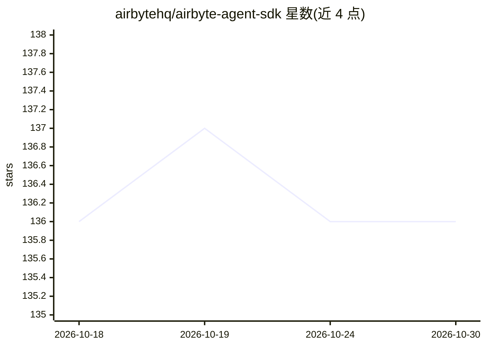

# airbytehq/airbyte-agent-sdk

⭐ 136 · Python · NOASSERTION · 推送 2026-10-29 · [GitHub](https://github.com/airbytehq/airbyte-agent-sdk) · [官网](https://airbyte.com/agents) · 组织维护

**给 AI agent 提供第三方 API 连接器工具的 Python SDK**

Airbyte 公司维护的 Python SDK：将 50+ 第三方 API 连接器封装为带 IDE 补全的类型化工具，用本地凭据直连各第三方 API。提供工具构建器 build_connector_tools 与 agent_tool 装饰器，把连接器调用转为 LLM 工具，含重试感知的异常翻译、输出大小防护（默认 100KB 上限）与按框架（PydanticAI/LangChain/OpenAI Agents/FastMCP）的错误信号。每个 agent 只能绑定一个连接器的默认工具集；旧 tool_utils 已标记废弃。另附可通过 npx 或 Claude Code 插件安装的 agent skills。

## 筛选速览

| 维度 | 判定 | 备注 |
|---|---|---|
| AI 角色 | `ai-ecosystem` | LLM/agent 周边工具 |
| 许可风险 | `none` | NOASSERTION |
| 部署形态 | `library` | 以包/库形式分发 |
| 模型依赖 | — | README 未给出锁定关系 |
| 硬件要求 | — | 无带数字的原话,不猜 |
| 安装摩擦 | `low` | 无编译、无系统依赖或容器化 |
| 成熟度 | — | 结构信号不足 |

## 能力要点

- 50+ 连接器的类型化工具与 IDE 自动补全
- build_connector_tools / agent_tool 将连接器调用转为 LLM 工具
- 重试感知异常翻译与输出大小防护（默认 100KB）
- 支持 PydanticAI / LangChain / OpenAI Agents / FastMCP 框架信号

## 适用场景

- 为 AI agent 接入 Stripe 等第三方 API 并控制权限与凭据
- 在 LangChain / PydanticAI 等框架中注册连接器工具
- 通过 skills 为 Claude Code / Codex 等编程 agent 安装连接器使用说明

## 场景标签

`Agent 框架` · 领域:Agent 开发

## 证据(README 行号)

> L7: The Airbyte Agent SDK provides 50+ connectors with typed tools for third-party APIs. Run connectors locally with you
> L17: The SDK ships a tool builder and two connector-tool decorators for turning connector calls into LLM tools with retr

## 星数曲线

2026-10-18 136 → 2026-10-30 136（+0）

---
*卡片 v1 · prompt 1.4 · 生成 2026-10-22 · 置信度 high · 依据 README sha `33effc635645` · [字段定义](../../DATASET.md)*
