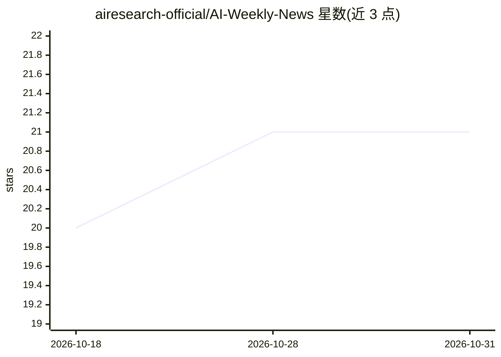

# airesearch-official/AI-Weekly-News

⭐ 21 · 推送 2026-10-29 · [GitHub](https://github.com/airesearch-official/AI-Weekly-News) · 组织维护

**每周 AI 新闻与开源工具的视频存档清单**

由 AI Research 维护的 AI 新闻周更知识存档：按周列出视频标题、日期与 YouTube 链接，内容覆盖模型发布、开源项目、研究论文实现与开发者工具等主题。仓库本身不含代码或可安装产物，条目为新闻摘要索引形式；提供按年份浏览的结构，并声明随时间持续追加。定位是面向开发者与创作者的资讯聚合与回溯查阅入口。

## 筛选速览

| 维度 | 判定 | 备注 |
|---|---|---|
| AI 角色 | `ai-knowledge` | 知识聚合/清单类 |
| 许可风险 | `none` | — |
| 部署形态 | `None` |  |
| 模型依赖 | — | README 未给出锁定关系 |
| 硬件要求 | — | 无带数字的原话,不猜 |
| 安装摩擦 | `low` | 无编译、无系统依赖或容器化 |
| 成熟度 | — | 结构信号不足 |

## 能力要点

- 每周更新并附 YouTube 视频链接的 AI 新闻条目
- 覆盖模型发布、开源 AI 项目与研究论文实现等主题
- 按年份组织的浏览结构

## 适用场景

- 回溯查找某一周的 AI 新闻与开源工具动态
- 跟踪模型发布与开源项目进展的视频来源
- 开发者与创作者按主题浏览 AI 资讯存档

## 场景标签

`精选清单` · 领域:学习与行业

## 证据(README 行号)

> L3: Welcome to **AI Weekly News**, a curated archive of the latest developments in **Artificial Intelligence, open-sourc
> L104: This repository is maintained by AI Research and serves as a **knowledge archive** for:

## 星数曲线

2026-10-18 20 → 2026-10-31 21（+1）

---
*卡片 v1 · prompt 1.4 · 生成 2026-10-28 · 置信度 high · 依据 README sha `d8b607055df4` · [字段定义](../../DATASET.md)*
