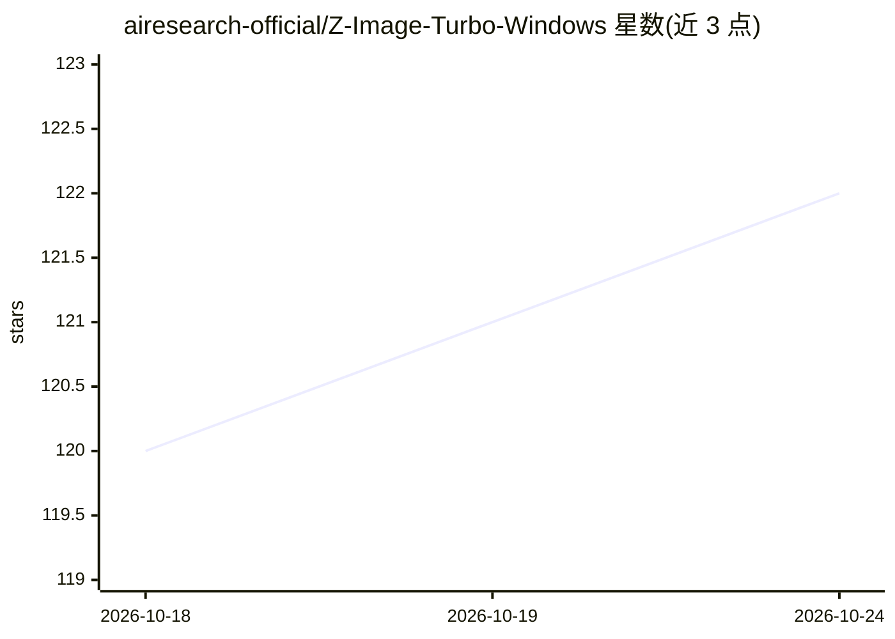

# airesearch-official/Z-Image-Turbo-Windows

⭐ 122 · Python · MIT · 推送 2026-06-11 · [GitHub](https://github.com/airesearch-official/Z-Image-Turbo-Windows) · 组织维护

**给 Windows 低显存用户的 Z-Image Turbo 本地文生图一键安装包**

面向低显存（含 4GB）NVIDIA GPU 用户和想免费本地生图的新手的一键 Windows 安装包：双击 start_zimage.bat 触发首跑向导，自动创建 Python venv、检测硬件、下载 Z-Image Turbo GGUF 模型、VAE 与 Qwen 文本编码器，并拉取 stable-diffusion.cpp 推理后端，随后启动 Gradio Web UI（127.0.0.1:9000）。提供 4GB/6-8GB/10GB+ 低显存预设（CPU offload、flash attention、VAE tiling）、后台生成队列、LoRA 加载，以及实验性 img2img 与 inpainting。仅限 Windows 10/11 64 位，需 Python 3.10+ 与 VC++ 运行库，NVIDIA GPU 为可选。

## 筛选速览

| 维度 | 判定 | 备注 |
|---|---|---|
| AI 角色 | `ai-native` | 本体是模型或模型工具 |
| 许可风险 | `permissive` | MIT |
| 部署形态 | `desktop` | 安装包/桌面程序 |
| 模型依赖 | — | README 未给出锁定关系 |
| 硬件要求 | `gpu-8g` | |
| 安装摩擦 | `medium` | 含编译或系统依赖之一 |
| 成熟度 | `idea` | |

## 能力要点

- 一键 bat 安装：自动建 venv、检测硬件、下载模型与 stable-diffusion.cpp 后端
- 4GB/6-8GB/10GB+ 低显存预设（CPU offload、diffusion flash attention、VAE tiling）
- 后台生成队列与 LoRA（.safetensors）加载
- 实验性 img2img 与 inpainting（基于 --init-img/--mask/--strength）

## 适用场景

- 在 4GB 显存笔记本上免费本地生成图片
- 不想手动配置 ComfyUI 等复杂工具的新手一键跑文生图
- 用 LoRA 定制生成风格，或在生成中排队批量出图

## 场景标签

`图像生成` · 领域:内容生成

## 证据(README 行号)

> L8: A beginner-friendly Windows package to run **Z-Image Turbo (GGUF)** locally with a simple **Gradio Web UI**.
> L24: - Gradio Web UI with prompt, resolution, seed tools, CFG, timer, stop button, and recent output gallery
> L103: The app uses **stable-diffusion.cpp** as the inference backend. Older releases used one main executable named `sd.

## 星数曲线

2026-10-18 120 → 2026-10-24 122（+2）

---
*卡片 v1 · prompt 1.4 · 生成 2026-10-23 · 置信度 high · 依据 README sha `8c2db464a20d` · [字段定义](../../DATASET.md)*
