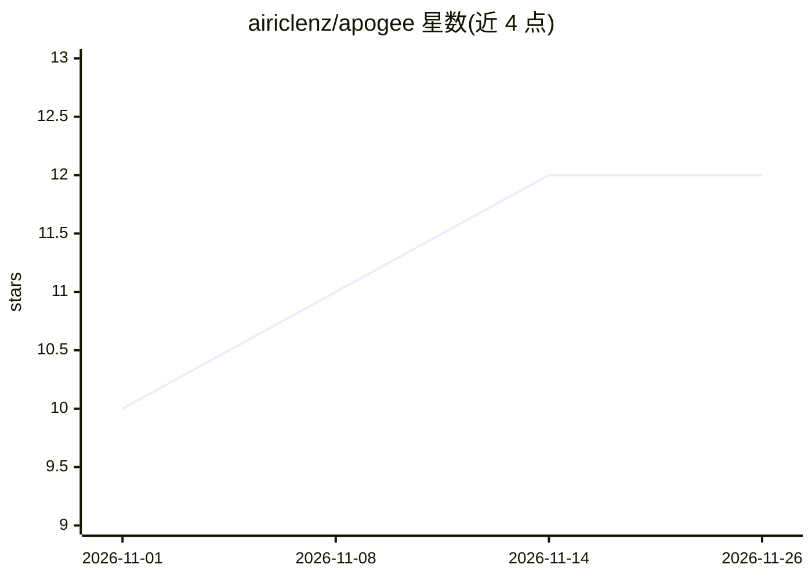

# airiclenz/apogee

⭐ 12 · Go · MIT · 推送 2026-11-25 · [GitHub](https://github.com/airiclenz/apogee) · [官网](https://airiclenz.com) · 个人维护

**面向本地 LLM 的终端 AI 编码 agent，Go 单二进制**

一个在终端运行的 AI 编码 agent，指向本地模型服务器（llama.cpp、Ollama、LM Studio、vLLM）或任意 OpenAI 兼容端点即可工作，无需 API key、可离线运行。内置 36 个工具覆盖文件读写、git、终端、测试、网页搜索与子 agent 委派；为小模型提供七项常驻容错守卫（修复畸形工具调用、重试空回复等）；四种自治模式中 Auto 由操作系统机制（Linux landlock/bwrap、macOS seatbelt、Windows 受限 token）约束写入范围。提供 headless/daemon 模式与可嵌入的 Go 引擎，TUI 是其首个前端。

## 筛选速览

| 维度 | 判定 | 备注 |
|---|---|---|
| AI 角色 | `ai-native` | 本体是模型或模型工具 |
| 许可风险 | `permissive` | MIT |
| 部署形态 | `desktop` | 安装包/桌面程序 |
| 模型依赖 | local-ok | 支持本地模型 |
| 硬件要求 | — | 无带数字的原话,不猜 |
| 安装摩擦 | `low` | 无编译、无系统依赖或容器化 |
| 成熟度 | — | 结构信号不足 |

## 能力要点

- 七项常驻守卫提升小本地模型的工具调用可靠性
- Auto 自治模式由 OS 级沙箱（landlock/seatbelt/受限 token）约束
- 36 个内置工具、MCP 服务器、并行子 agent 与 workflow 技能
- 跨 Windows/macOS/Linux 的静态单二进制，支持自更新与 SHA256 校验

## 适用场景

- 在本地模型上运行编码 agent，代码不出本机
- 离线环境下完成修测试、改代码、跑 git 等开发任务
- 用不同模型分别驱动主 agent 与子 agent 分工干活
- 通过 skills 与 workflow 批量处理多条目任务

## 场景标签

`编码 Agent` · 领域:编码与开发

## 证据(README 行号)

> L10: **apogee is an open-source AI coding agent that runs in your terminal and works with
> L40:  from read-only Plan up to unsupervised Auto — and Auto is confined at the OS level on
> L53: Under the hood apogee is an embeddable Go engine; the terminal UI is its first front-end,

## 星数曲线

2026-11-01 10 → 2026-11-26 12（+2）

---
*卡片 v1 · prompt 1.4 · 生成 2026-11-18 · 置信度 high · 依据 README sha `5ad068251e08` · [字段定义](../../DATASET.md)*
