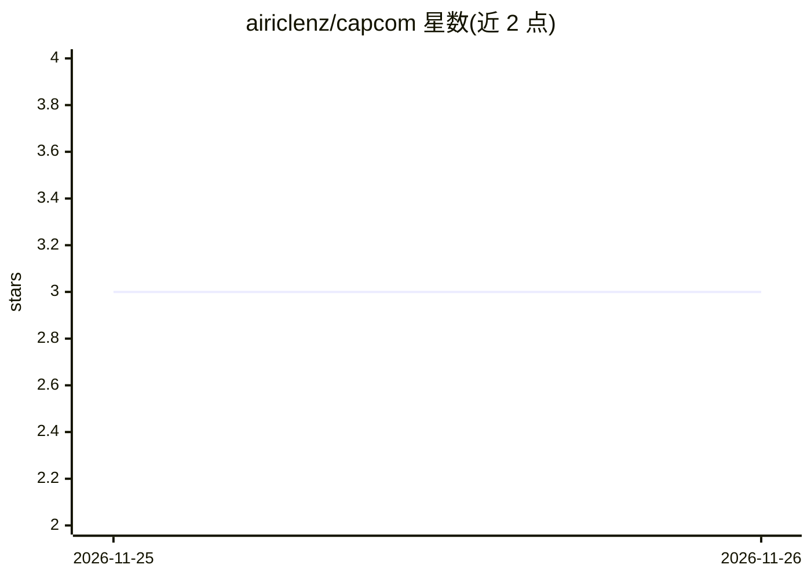

# airiclenz/capcom

⭐ 3 · Go · MIT · 推送 2026-11-25 · [GitHub](https://github.com/airiclenz/capcom) · [官网](https://airiclenz.com/capcom/) · 个人维护

**给 AI 编码 agent 及开发者的 git 原生 issue 跟踪与知识库**

capcom 是命令行 issue 跟踪器、任务管理器与项目知识库：issue 与笔记是仓库内的 markdown 文件，以 git 为唯一存储，无服务器、无账号、无数据库同步，.git 下维护自动重建的 SQLite 本地缓存索引。提供 CLI 供 agent 调用（--json/--kv 机器可读输出）和终端 UI 供人浏览编辑。支持 issue 依赖与自定义状态、并行 agent 的 tree lock、按需读取的 Knowledge Notes、会话简报（capcom prime）、HTML 静态导出与 CI 校验。非目标中明确不做服务器、后台进程和通知。

## 筛选速览

| 维度 | 判定 | 备注 |
|---|---|---|
| AI 角色 | `ai-enhanced` | 去掉 AI 部分产品仍成立 |
| 许可风险 | `permissive` | MIT |
| 部署形态 | `desktop` | 安装包/桌面程序 |
| 模型依赖 | — | README 未给出锁定关系 |
| 硬件要求 | — | 无带数字的原话,不猜 |
| 安装摩擦 | `low` | 无编译、无系统依赖或容器化 |
| 成熟度 | — | 结构信号不足 |

## 能力要点

- issue 为仓库内 markdown 文件，git 为唯一真源，无服务器与同步
- tree lock 支持 agent 并行工作，每 worktree 一把锁
- Knowledge Notes 让 agent 按需读取项目知识，know verify 标记失效条目
- 所有命令输出 --json/--kv，capcom check/fmt 可用于 CI

## 适用场景

- 为 Claude Code、Codex、Cursor 等 agent 管理任务与依赖关系
- 多 agent 并行编辑同一仓库时用 tree lock 协调
- 把项目约定与设计决策作为可提交的知识文件跨会话传递
- 用 CI 校验 issue 文件格式

## 场景标签

`知识库管理` · 领域:知识与检索

## 证据(README 行号)

> L12: capcom is a command-line issue tracker, task manager and project knowledge base for AI coding
> L152: - **A server or hosting.** The repository is the only store; git already handles many writers.
> L214: **Is it only for AI agents?**
> L215: No. The files are readable markdown, and the terminal UI and plain-text output are made for

## 星数曲线

2026-11-25 3 → 2026-11-26 3（+0）

---
*卡片 v1 · prompt 1.4 · 生成 2026-11-24 · 置信度 high · 依据 README sha `41d69a493646` · [字段定义](../../DATASET.md)*
