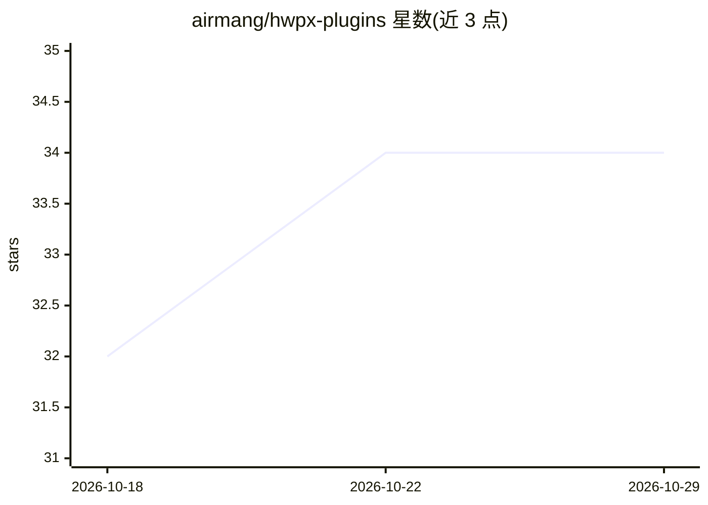

# airmang/hwpx-plugins

⭐ 34 · Python · Apache-2.0 · 推送 2026-10-25 · [GitHub](https://github.com/airmang/hwpx-plugins) · [官网](https://airmang.github.io/python-hwpx/) · 个人维护

**让 AI 代理用自然语言处理韩文 HWPX 文档的技能插件包**

python-hwpx 项目维护的第一方 agent 技能包：通过 SKILL.md 决策树让 Claude Code、Codex、Cursor 等代理自行选择脚本与 MCP 工具，完成 HWPX/HWP 5.0 文档的读取、表单填充、生成、编辑、mail merge 与修复；文档处理由纯 Python 引擎 python-hwpx 完成，最终视觉验证按需使用韩文 Office。各宿主提供专门安装通道（Claude 插件市场、Codex 插件命令、Cursor 技能目录复制），claude.ai 聊天等无 MCP 环境使用捆绑引擎。核心标注 Alpha 状态，需 Python 3.10 以上。

## 筛选速览

| 维度 | 判定 | 备注 |
|---|---|---|
| AI 角色 | `ai-ecosystem` | LLM/agent 周边工具 |
| 许可风险 | `permissive` | Apache-2.0 |
| 部署形态 | `library` | 以包/库形式分发 |
| 模型依赖 | locked-api |  |
| 硬件要求 | — | 无带数字的原话,不猜 |
| 安装摩擦 | `low` | 无编译、无系统依赖或容器化 |
| 成熟度 | `idea` | |

## 能力要点

- SKILL.md 决策树让代理自行选择脚本与 MCP 工具
- 能力覆盖读取、字节保留表单填充、文档生成、mail merge、损坏文档修复
- 五类宿主（Claude Code/Codex/Cursor/OpenClaw/Hermes）入口由同一源构建
- MCP 不可用时回退到内置引擎（chat-engine.md 路径）

## 适用场景

- 用自然语言让 AI 代理抽取或填写 HWPX 文档内容
- 按模板批量生成带页眉页码的韩文公文/计划书
- 修复韩文 Office 打不开的 HWPX 文件

## 场景标签

`文档解析` · 领域:知识与检索

## 证据(README 行号)

> L95: - **에이전트 온보딩 스킬** — `SKILL.md` 의사결정 트리로 요청 성격에 맞는 스크립트·MCP 도구를 스스로 선택
> L97: - **MCP 서버 동봉 배선** — 호스트별 MCP 설정과 런처가 포함되어 스킬과 도구가 한 번에 로드
> L98: - **호스트별 번들** — Claude Code·Codex·Cursor·OpenClaw·Hermes 진입점을 한 canonical 소스에서 빌드

## 星数曲线

2026-10-18 32 → 2026-10-29 34（+2）

---
*卡片 v1 · prompt 1.4 · 生成 2026-10-25 · 置信度 mid · 依据 README sha `0a60711f303f` · [字段定义](../../DATASET.md)*
