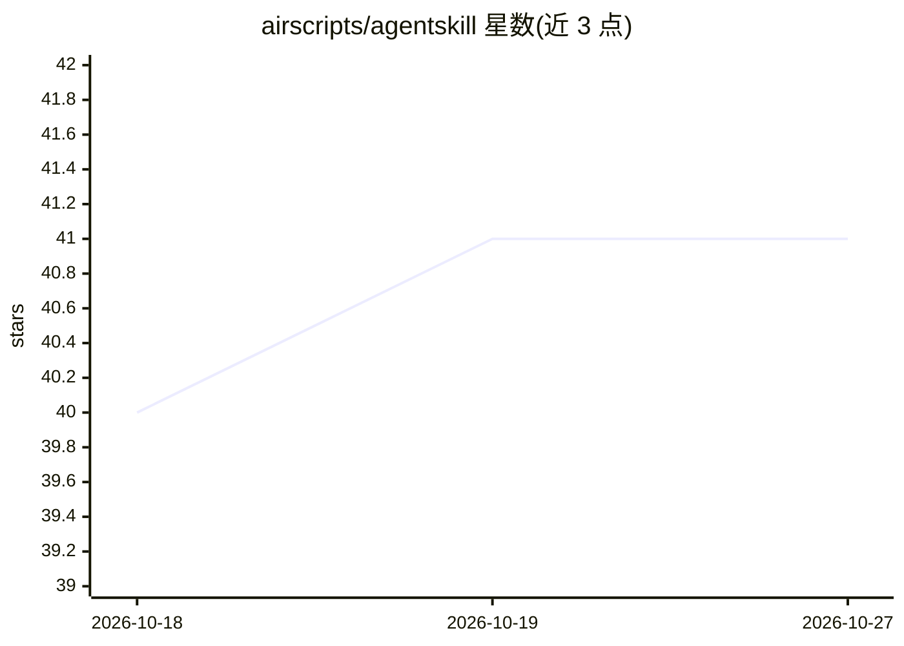

# airscripts/agentskill

⭐ 41 · Rust · MIT · 推送 2026-09-13 · [GitHub](https://github.com/airscripts/agentskill) · [官网](https://github.com/airscripts/agentskill/releases) · 个人维护

**将代码库转化为 AGENTS.md 手册供 AI 编程代理遵循的 Rust CLI**

面向使用 AI 编程代理的开发者的取证式仓库分析工具：以 7 个 Rust 分析器并行扫描目录结构、源码规范、格式化/linter 配置、Git 历史、导入图、符号与测试框架，输出稳定 JSON 证据；LLM 技能层据此撰写面向代理的 AGENTS.md 指南，CLI 保持确定性与只读，并提供 validate/drift 校验文档新鲜度。覆盖 60 个语言族。安装方式为 GitHub Releases 归档或 Cargo 源码构建，语义性 Markdown 由 LLM 技能而非 CLI 生成。

## 筛选速览

| 维度 | 判定 | 备注 |
|---|---|---|
| AI 角色 | `ai-ecosystem` | LLM/agent 周边工具 |
| 许可风险 | `permissive` | MIT |
| 部署形态 | `self-host` | docker 或自建部署 |
| 模型依赖 | — | README 未给出锁定关系 |
| 硬件要求 | — | 无带数字的原话,不猜 |
| 安装摩擦 | `low` | 无编译、无系统依赖或容器化 |
| 成熟度 | — | 结构信号不足 |

## 能力要点

- 7 个并行分析器输出稳定 JSON 证据（scan/measure/config/git/graph/symbols/tests）
- 覆盖 60 个语言族的目标语言分析矩阵
- LLM 技能层依据证据撰写 AGENTS.md，CLI 只读且确定性
- validate 与 drift 命令校验生成文档的合规与新鲜度

## 适用场景

- 为 AI 编程代理生成本仓库专属的 AGENTS.md 操作手册
- 检测已生成代理指南与仓库现状之间的漂移
- 获取紧凑的 LLM-ready 仓库事实证据供代理消费

## 场景标签

`提示工程` · 领域:Agent 开发

## 证据(README 行号)

> L6: Turn any codebase into an `AGENTS.md` playbook AI coding agents can actually
> L96: The LLM skill uses that evidence to author compact, repository-specific
> L198: `agentskill-skill/`. An agent harness can install that

## 星数曲线

2026-10-18 40 → 2026-10-27 41（+1）

---
*卡片 v1 · prompt 1.4 · 生成 2026-10-25 · 置信度 mid · 依据 README sha `6dc4c8a4e61c` · [字段定义](../../DATASET.md)*
