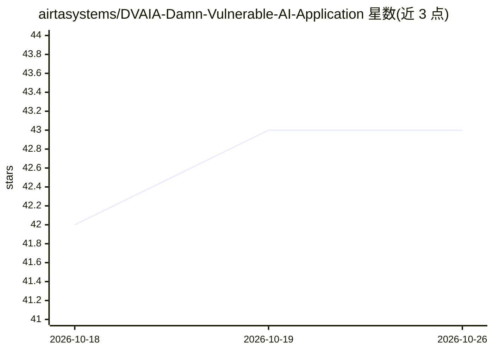

# airtasystems/DVAIA-Damn-Vulnerable-AI-Application

⭐ 43 · Python · 推送 2026-07-21 · [GitHub](https://github.com/airtasystems/DVAIA-Damn-Vulnerable-AI-Application) · 组织维护

**面向 LLM 红队训练的漏洞靶场 Web 应用**

DVWA 风格的 AI 安全训练平台：Flask Web 应用运行在 127.0.0.1:5000，提供 8 个攻击面板，覆盖提示注入、越狱、间接注入、RAG 投毒（内置 Qdrant）、Agent 工具滥用、多模态攻击（PDF/DOCX/图像/音频）与模板注入，对齐 OWASP LLM Top 10。LLM 后端可在本地 Ollama、Google Gemini、OpenAI 间切换；Whisper 转录与 OCR 始终本地运行。面向 AI 安全研究人员与红队人员，支持 Docker Compose 或 Python venv 部署。

## 筛选速览

| 维度 | 判定 | 备注 |
|---|---|---|
| AI 角色 | `ai-ecosystem` | LLM/agent 周边工具 |
| 许可风险 | `none` | — |
| 部署形态 | `self-host` | docker 或自建部署 |
| 模型依赖 | local-ok | 支持本地模型 |
| 硬件要求 | — | 无带数字的原话,不猜 |
| 安装摩擦 | `low` | 无编译、无系统依赖或容器化 |
| 成熟度 | — | 结构信号不足 |

## 能力要点

- 8 个攻击面板：直连注入/RAG/Agent/多模态/模板注入等
- LLM 后端三选一：本地 Ollama、Gemini、OpenAI，Settings 内切换
- 多模态载荷生成：PDF、DOCX、图像、音频、QR 等
- faster-whisper 本地 STT 与 Tesseract OCR，无需云服务

## 适用场景

- 在受控靶场练习提示注入与越狱等 LLM 攻击手法
- 测试 RAG 向量库投毒与检索滥用
- 演练 Agent 工具滥用与数据外传场景
- 学习 OWASP LLM Top 10 攻击向量

## 场景标签

`网络安全` · 领域:学习与行业

## 证据(README 行号)

> L3: **Open-source lab for LLM red teaming, AI agent testing, RAG security testing, and multimodal payload generation.**
> L20: - Educational platform aligned with **OWASP LLM Top 10** attack vectors

## 星数曲线

2026-10-18 42 → 2026-10-26 43（+1）

---
*卡片 v1 · prompt 1.4 · 生成 2026-10-25 · 置信度 mid · 依据 README sha `de7abb10141c` · [字段定义](../../DATASET.md)*
