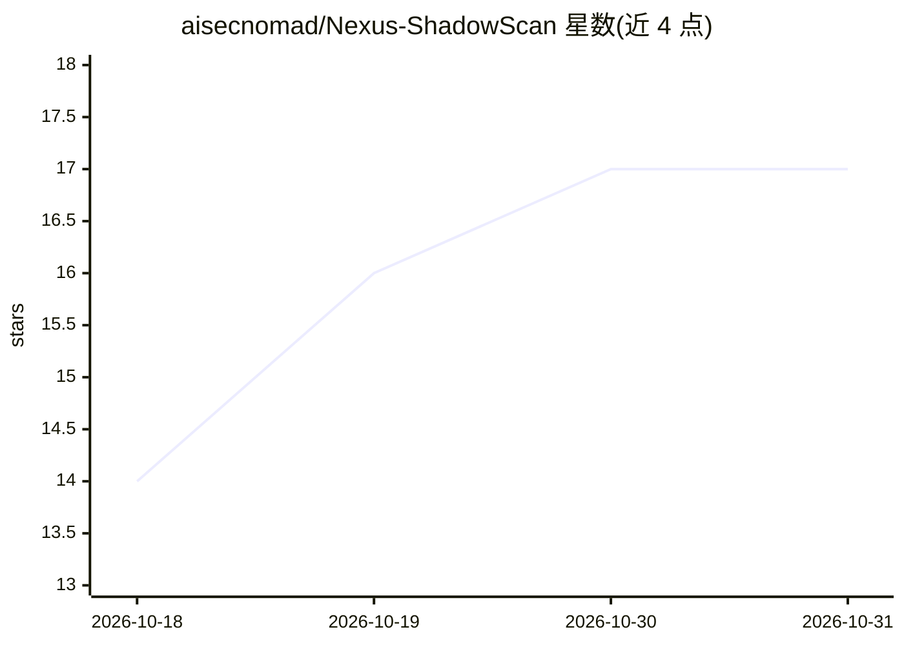

# aisecnomad/Nexus-ShadowScan

⭐ 17 · Python · Apache-2.0 · 推送 2026-10-27 · [GitHub](https://github.com/aisecnomad/Nexus-ShadowScan) · [官网](https://medium.com/@EmmanuelDahunsi) · 个人维护

**扫描组织内影子 AI agent 证据并与已批准清单对账的安全工具**

面向安全调查员与审计人员的 CLI 工具，在 9 类表面（代码库、身份提供方、LLM 网关日志、低代码平台、SaaS、云账户、终端、网络日志、运行中进程）发现 AI 使用与 agent 证据，通过 38 个连接器采集、以 YAML 签名包识别 233 种签名，与传入的已批准 agent 清单对账标记 shadow 项。检测知识存于 YAML 数据而非代码；采集与分析 fail-closed（错误即 exit 3 而非产出缩水报告）；凭据与 JWT 在落盘前脱敏。仅 Python 3.11–3.14，Windows 不受支持。

## 筛选速览

| 维度 | 判定 | 备注 |
|---|---|---|
| AI 角色 | `ai-ecosystem` | LLM/agent 周边工具 |
| 许可风险 | `permissive` | Apache-2.0 |
| 部署形态 | `library` | 以包/库形式分发 |
| 模型依赖 | — | README 未给出锁定关系 |
| 硬件要求 | — | 无带数字的原话,不猜 |
| 安装摩擦 | `low` | 无编译、无系统依赖或容器化 |
| 成熟度 | — | 结构信号不足 |

## 能力要点

- 38 个连接器覆盖 9 类表面，支持 live API 与离线导出两种模式
- 233 个签名/1133 个信号，识别新产品通常是数据变更而非代码变更
- 8 种输出格式（table/json/sarif/csv/markdown/html/cyclonedx/ocsf）
- fail-closed 设计与确定性退出码，凭据/JWT 落盘前脱敏

## 适用场景

- 盘点组织内未经批准的影子 AI agent 并与登记清单对账
- 在 CI/CD 中以 SARIF 上传与确定性退出码做漂移门禁
- 跨代码、网关日志、云账户等多表面调查某 AI agent 的归属与能力

## 场景标签

`网络安全` · 领域:学习与行业

## 证据(README 行号)

> L10:  Discover evidence of shadow AI agents across your organization and reconcile it against your inventory of approved
> L12: It inspects nine surfaces: code repositories, identity providers, LLM gateway logs,
> L150: |**38 connectors** across 9 surfaces|Code, Identity, Gateway, Low-code, SaaS, Cloud, Endpoint, Network, Runtime|

## 星数曲线

2026-10-18 14 → 2026-10-31 17（+3）

---
*卡片 v1 · prompt 1.4 · 生成 2026-10-30 · 置信度 high · 依据 README sha `8d3ce8946472` · [字段定义](../../DATASET.md)*
