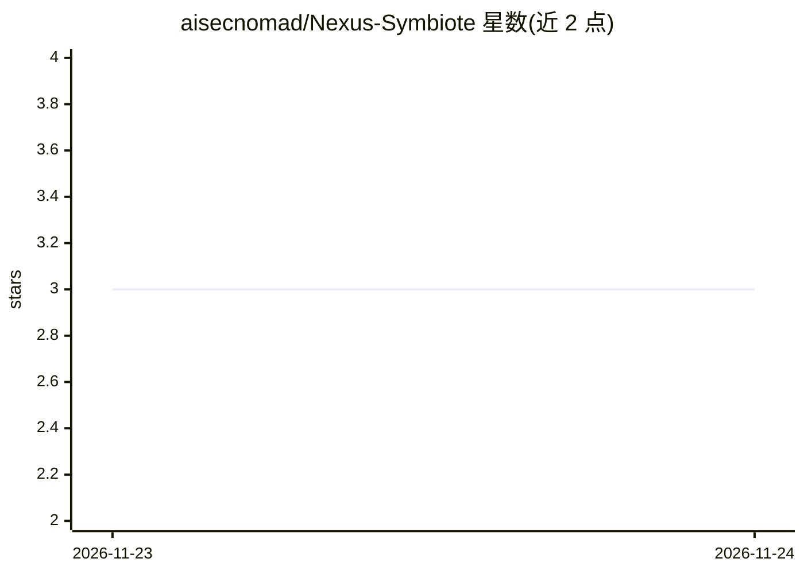

# aisecnomad/Nexus-Symbiote

⭐ 3 · Python · MIT · 推送 2026-11-22 · [GitHub](https://github.com/aisecnomad/Nexus-Symbiote) · [官网](https://medium.com/@EmmanuelDahunsi/the-supply-chain-of-agency-c73667e08162) · 个人维护

**为 AI Agent 供应链生成证据化物料清单的扫描工具**

生成 AgentBOM：静态读取项目（不执行代码），盘点 MCP 服务器、模型权重、指令文件、检索源、A2A 卡片、IDE 设置与容器镜像，标注风险项（未固定版本、端点漂移、隐藏指令、过宽权限等），支持以 diff 做漂移门禁接入 CI。导出 CycloneDX 1.7、SPDX 3.0.1、SARIF、VEX 格式。当前为 alpha 状态，接口与格式可能变化，安装方式要求校验构建证明或从源码审阅后安装，且声明存在已知检测盲区。

## 筛选速览

| 维度 | 判定 | 备注 |
|---|---|---|
| AI 角色 | `ai-ecosystem` | LLM/agent 周边工具 |
| 许可风险 | `permissive` | MIT |
| 部署形态 | `None` |  |
| 模型依赖 | — | README 未给出锁定关系 |
| 硬件要求 | — | 无带数字的原话,不猜 |
| 安装摩擦 | `medium` | 含编译或系统依赖之一 |
| 成熟度 | `idea` | |

## 能力要点

- 8 个静态收集器盘点 MCP/模型/提示/RAG/A2A 等组件，不执行被扫项目
- 基于已审阅基线做 diff 漂移门禁，可在 CI 中 fail-on-alert
- 导出 CycloneDX 1.7 / SPDX 3.0.1 / SARIF / VEX 标准格式
- SafeTensors 头校验与基于签名策略的模型完整性验证

## 适用场景

- 给团队 AI Agent 项目建立可审计的组件清单
- CI 中拦截 MCP 包版本或端点的未审变更
- 合规场景下对接 OWASP/MITRE ATLAS/EU AI Act 交叉映射
- 检测指令文件中的隐藏字符与过宽权限配置

## 场景标签

`网络安全` · 领域:学习与行业

## 证据(README 行号)

> L23: Nexus SymBiote generates an **Agent Bill of Materials (AgentBOM)** — an evidence-backed inventory of the MCP server
> L126: 3. **Gate.** `validate` checks completeness and recorded local digests, bindings and operator-supplied signature p
> L145: ### Commands

## 星数曲线

2026-11-23 3 → 2026-11-24 3（+0）

---
*卡片 v1 · prompt 1.4 · 生成 2026-11-23 · 置信度 high · 依据 README sha `51dc286c8ab2` · [字段定义](../../DATASET.md)*
