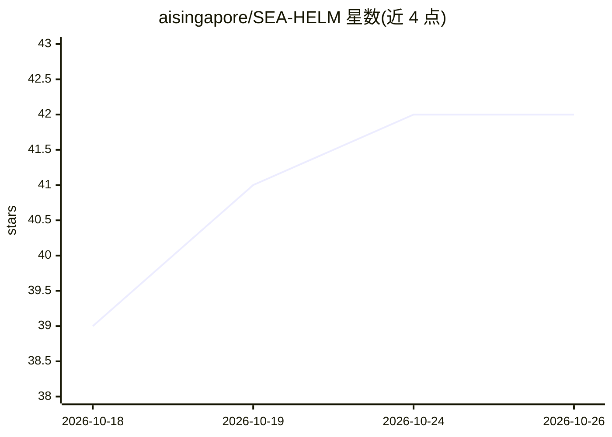

# aisingapore/SEA-HELM

⭐ 42 · Python · MIT · 推送 2026-08-05 · [GitHub](https://github.com/aisingapore/SEA-HELM) · [官网](https://leaderboard.sea-lion.ai/) · 组织维护

**东南亚语言 LLM 评测套件：五大维度评估模型表现**

AI Singapore 维护的东南亚语言大模型评测套件 SEA-HELM，覆盖 NLP 经典任务、LLM 特性、东南亚语言学、文化与安全五大支柱；采用每模型 8 次独立运行的评测方法，结合 Bootstrap 计算置信区间，支持 LLM-as-a-Judge（GPT-4.1）、MetricX 翻译评测与 ELO 计算。通过 uv 管理环境，提供 PBS/SLURM 作业调度脚本、bash 脚本与 CLI 三种运行方式，推理后端支持 vLLM 与 AWS Bedrock。数据集托管于 Hugging Face，需设置 HF_TOKEN 与 OPENAI_API_KEY。面向研究者评估东南亚语言模型能力。

## 筛选速览

| 维度 | 判定 | 备注 |
|---|---|---|
| AI 角色 | `ai-ecosystem` | LLM/agent 周边工具 |
| 许可风险 | `permissive` | MIT |
| 部署形态 | `None` |  |
| 模型依赖 | local-ok | 支持本地模型 |
| 硬件要求 | — | 无带数字的原话,不猜 |
| 安装摩擦 | `low` | 无编译、无系统依赖或容器化 |
| 成熟度 | — | 结构信号不足 |

## 能力要点

- 五大评测支柱：NLP 经典、LLM 特性、东南亚语言学、文化与安全
- 8 次独立运行评测与 Bootstrap 置信区间计算
- 支持 LLM-as-a-Judge、MetricX 翻译评测与 ELO 评分
- 提供 PBS/SLURM 调度脚本、bash 脚本与 CLI 三种运行方式

## 适用场景

- 评估 LLM 在东南亚语言（马来语、缅甸语、老挝语、高棉语等）上的表现
- 在集群（SLURM/PBS）上批量运行模型评测
- 为研究论文提供东南亚语言的标准化基准结果

## 场景标签

`模型评测` · 领域:评测与运维

## 证据(README 行号)

> L78: SEA-HELM (SouthEast Asian Holistic Evaluation of Language Models) is an assessment of large language models (LLMs) 
> L80: This suite consist of 5 core pillars to evaluate the performance of LLMs across a range of key capabilities in the 

## 星数曲线

2026-10-18 39 → 2026-10-26 42（+3）

---
*卡片 v1 · prompt 1.4 · 生成 2026-10-25 · 置信度 high · 依据 README sha `d9248f7b8cd7` · [字段定义](../../DATASET.md)*
