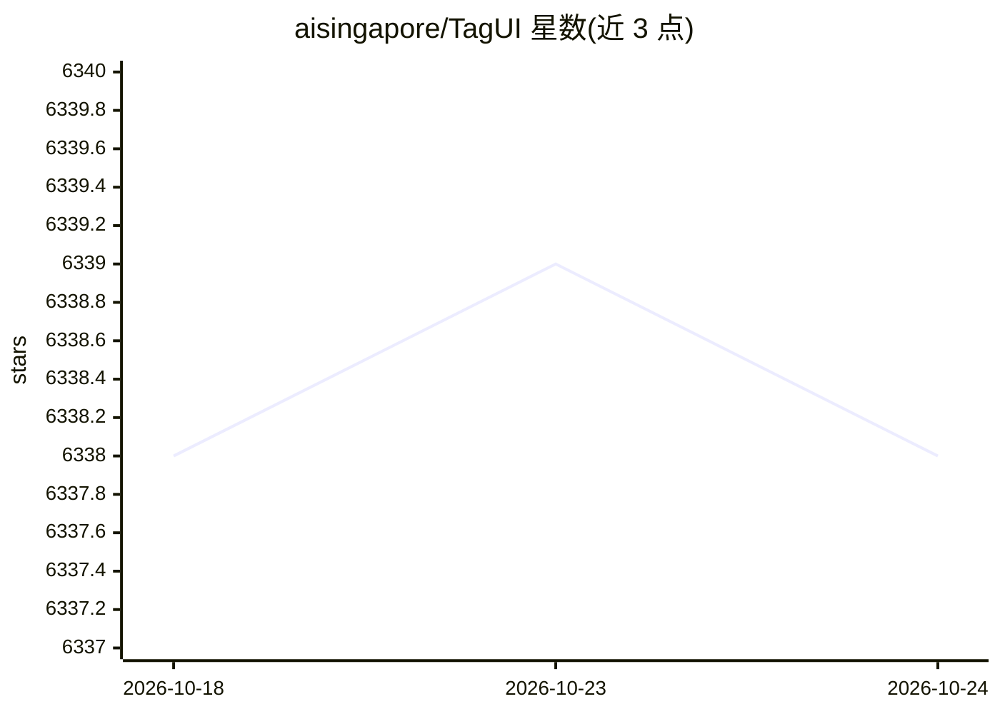

# aisingapore/TagUI

⭐ 6,338 · JavaScript · Apache-2.0 · 推送 2026-10-21 · [GitHub](https://github.com/aisingapore/TagUI) · 组织维护 · 中文 README

**开源 RPA 工具：用简单语言脚本自动化网页、桌面与命令行任务**

命令行 RPA 工具，用户以 TagUI 语言编写流程步骤（click、type 等），通过网页标识符、UI 元素图像、屏幕坐标或 OCR 文本定位，自动化浏览器（原生支持 Chrome/Edge）、桌面应用和命令行操作。支持 23 种语言编写流程、Excel 数据交互、MS Office 插件生成机器人，以及与 Power Automate Desktop 双向集成。原维护方 AI Singapore 已停止维护，项目转由社区维护。Windows/macOS/Linux 可用，提供 v6.114 下载。

## 筛选速览

| 维度 | 判定 | 备注 |
|---|---|---|
| AI 角色 | `ai-enhanced` | 去掉 AI 部分产品仍成立 |
| 许可风险 | `permissive` | Apache-2.0 |
| 部署形态 | `library` | 以包/库形式分发 |
| 模型依赖 | — | README 未给出锁定关系 |
| 硬件要求 | — | 无带数字的原话,不猜 |
| 安装摩擦 | `low` | 无编译、无系统依赖或容器化 |
| 成熟度 | — | 结构信号不足 |

## 能力要点

- click/type 等步骤式语言，支持 22 种非英语语言编写流程
- 网页标识符、图像、坐标、OCR 四种元素定位方式
- MS Office 插件可用 Word 文档创建 RPA 机器人
- 与 Microsoft Power Automate Desktop 双向集成

## 适用场景

- 自动化网站上重复性的数据录入与抓取
- 自动操作桌面应用并处理 Excel 数据
- 非编程背景用户用自然语言步骤描述自动化任务

## 场景标签

`工作流自动化` `浏览器自动化` · 领域:效率与自动化

## 证据(README 行号)

> L8: Write flows in simple TagUI language and automate away repetitive time-consuming tasks on your computer. Tasks inclu
> L14: In TagUI language, you use steps like `click` and `type` to interact with identifiers, which include web identifier

## 星数曲线

2026-10-18 6,338 → 2026-10-24 6,338（+0）

---
*卡片 v1 · prompt 1.4 · 生成 2026-10-20 · 置信度 mid · 依据 README sha `23da7a1afa17` · [字段定义](../../DATASET.md)*
