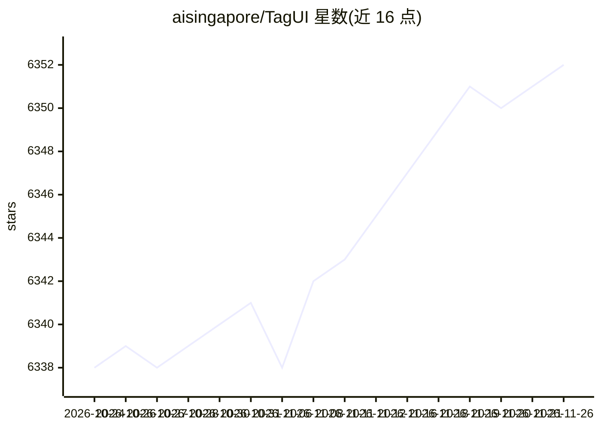

# aisingapore/TagUI

⭐ 6,352 · PHP · Apache-2.0 · 推送 2026-11-08 · [GitHub](https://github.com/aisingapore/TagUI) · 组织维护 · 中文 README

**开源 RPA 工具：用简单流程语言自动化网页/桌面/命令行任务**

TagUI 是 AI Singapore 开源维护、现由社区接手的 RPA 工具，用户用 23 种语言编写流程步骤（click/type/table 等），通过标识符、图像快照、屏幕坐标或 OCR 文本操作网页（Chrome/Edge）、桌面应用与命令行，并提供 turbo 模式。默认基于 CasperJS/SikuliX 运行，可 opt-in 切换到 DevTools 协议的现代 Chrome 引擎或 OculiX 视觉自动化。提供 Word/Excel 插件、VS Code/Notepad++ 扩展、MCP server 供 AI 客户端写运行流程；本机本地运行、不依赖云端，支持集中报告与企业白名单安装。原维护方已停止官方支持。

## 筛选速览

| 维度 | 判定 | 备注 |
|---|---|---|
| AI 角色 | `ai-enhanced` | 去掉 AI 部分产品仍成立 |
| 许可风险 | `permissive` | Apache-2.0 |
| 部署形态 | `desktop` | 安装包/桌面程序 |
| 模型依赖 | — | README 未给出锁定关系 |
| 硬件要求 | — | 无带数字的原话,不猜 |
| 安装摩擦 | `medium` | 含编译或系统依赖之一 |
| 成熟度 | — | 结构信号不足 |

## 能力要点

- 23 种语言编写 RPA 流程，支持网页/桌面/命令行自动化
- MCP server 允许 AI 客户端编写、检查、运行流程
- 可切换 DevTools 协议引擎或 OculiX 视觉自动化（Java 17+）
- 本机 on-prem 运行，无云端/数据存储

## 适用场景

- 自动抓取网页表格数据并导出为 CSV 或写入 Excel
- 用自然语言步骤编写办公自动化机器人
- 通过 MCP 让 AI 助手代写和运行自动化流程

## 场景标签

`工作流自动化` `GUI 自动化` · 领域:效率与自动化

## 证据(README 行号)

> L8: Write flows in simple TagUI language and automate away repetitive time-consuming tasks on your computer. Tasks inclu
> L17: - **TagUI MCP server.** `src/tagui_mcp` lets an MCP client such as an AI assistant write, check and run TagUI flows

## 星数曲线

2026-10-24 6,338 → 2026-11-26 6,352（+14）

---
*卡片 v1 · prompt 1.4 · 生成 2026-11-22 · 置信度 mid · 依据 README sha `5e7cf4eeede7` · [字段定义](../../DATASET.md)*
