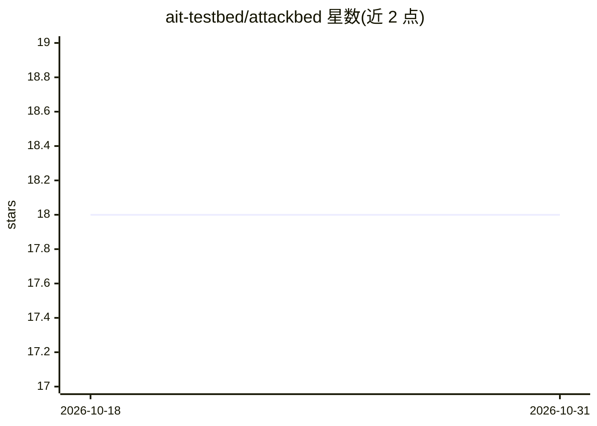

# ait-testbed/attackbed

⭐ 18 · Jinja · GPL-3.0 · 推送 2026-10-23 · [GitHub](https://github.com/ait-testbed/attackbed) · 组织维护

**自动化攻击靶场：生成带标签的入侵检测评估数据集**

在 OpenStack 虚拟化环境中构建含大量漏洞的模拟企业网络（Internet/DMZ/内网三段），通过 AttackMate 自动执行多步攻击场景，覆盖 MITRE ATT&CK 企业框架的多项战术与技术。场景包括视频服务器入侵、Linux 恶意软件、横向移动、ARP 欺骗/SSL 剥离、客户端社会工程、Docker 逃逸等，同时采集 apache/DNS/syslog/认证/suricata 等多种日志与网络流量，供取证分析、IDS 评估与数据集生成研究使用。需 OpenStack、OpenTofu、Terragrunt、Ansible 搭建。

## 筛选速览

| 维度 | 判定 | 备注 |
|---|---|---|
| AI 角色 | `ai-knowledge` | 知识聚合/清单类 |
| 许可风险 | `viral` | GPL-3.0 |
| 部署形态 | `None` |  |
| 模型依赖 | — | README 未给出锁定关系 |
| 硬件要求 | — | 无带数字的原话,不猜 |
| 安装摩擦 | `low` | 无编译、无系统依赖或容器化 |
| 成熟度 | — | 结构信号不足 |

## 能力要点

- 7 类多步攻击场景，覆盖 MITRE ATT&CK 企业框架战术与技术
- 自动执行攻击（AttackMate）并采集多源日志与网络流量
- 基于 OpenStack/OpenTofu/Ansible 的虚拟化靶场搭建脚本
- 配套多篇 IDS 数据集评估论文（IEEE TDSC 等）

## 适用场景

- 生成带攻击标签的日志数据集用于 IDS/HIDS 评估
- 在可控环境中复现多步 APT 式攻击做取证或实时分析研究
- 测试 MITRE ATT&CK 覆盖下的检测能力

## 场景标签

`网络安全` · 领域:学习与行业

## 证据(README 行号)

> L3: The AttackBed is a simulated enterprise network packed with numerous vulnerabilities. This testbed can be applied to
> L69: If you use the testbed environment or any of the generated datasets, please cite the following publications:
> L71: * Landauer M., Skopik F., Frank M., Hotwagner W., Wurzenberger M., Rauber A. (2023): Maintainable Log Datasets for 

## 星数曲线

2026-10-18 18 → 2026-10-31 18（+0）

---
*卡片 v1 · prompt 1.4 · 生成 2026-10-29 · 置信度 mid · 依据 README sha `49d6d96f6d40` · [字段定义](../../DATASET.md)*
