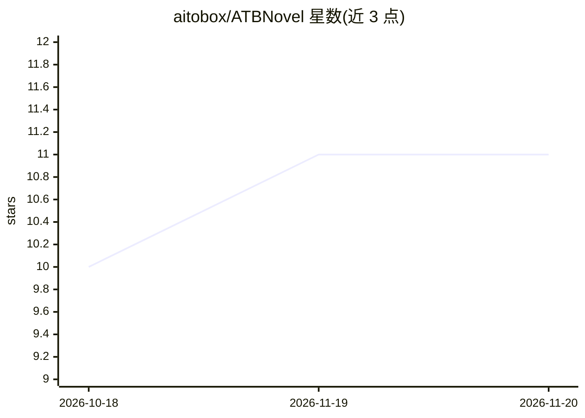

# aitobox/ATBNovel

⭐ 11 · HTML · MIT · 推送 2026-09-12 · [GitHub](https://github.com/aitobox/ATBNovel) · 个人维护 · 中文 README

**面向长篇小说创作者的全自动多智能体 AI 写作与管理平台**

基于 LLM 的长篇小说创作平台：将几百字大纲自动切分为章节任务队列，经三幕场景扩写循环生成十万至百万字手稿；写作中实时提取角色、道具、关系与悬念状态作为世界观记忆数据库，作为下一章上下文输入。支持导入已有小说做文风重塑/重写（多编码解析、篇幅缩放）、项目克隆分叉、单章提示词定向润色与原子采纳，提供 FastAPI Web 控制台与 RESTful API。运行需 Python 3.8+，需自配 LLM API 密钥，支持 Docker 部署。

## 筛选速览

| 维度 | 判定 | 备注 |
|---|---|---|
| AI 角色 | `ai-native` | 本体是模型或模型工具 |
| 许可风险 | `permissive` | MIT |
| 部署形态 | `self-host` | docker 或自建部署 |
| 模型依赖 | — | README 未给出锁定关系 |
| 硬件要求 | — | 无带数字的原话,不猜 |
| 安装摩擦 | `low` | 无编译、无系统依赖或容器化 |
| 成熟度 | — | 结构信号不足 |

## 能力要点

- 大纲切分→章节任务队列→三幕场景迭代扩写的自动化生成管线
- 世界观记忆数据库：实时提取角色动态、道具去向、情感关系与悬念并回注上下文
- 全书文风重塑/重写：支持 .txt/.md/.epub 导入、多编码解析、篇幅缩放 0.5x~20.0x
- 单章定向修改：自然语言提示词驱动润色，左右双栏对比后原子采纳更新手稿

## 适用场景

- 把几段核心大纲一键扩写成长篇连载小说手稿
- 对已有小说按古龙、金庸等文风模版做全书重塑或精修
- 克隆现有小说项目做平行世界分叉与二次创作
- 通过 RESTful API 将小说生成管线集成到自有系统

## 场景标签

`多智能体` `AI 写作` · 领域:Agent 开发

## 证据(README 行号)

> L3: 艾特智能写作工厂是一款专为史诗长篇小说创作而设计的**全自动、多智能体深度协同的 AI 写作与管理平台**。平台基于大语言模型（LLM）驱动，通过创新的**多幕场景迭代扩写**与**世界观/角色记忆数据库管理**机制，能够一键将几百
> L15: - **大纲切分与任务编排**：系统能够自动分析用户输入的核心小说大纲，并将其切分为结构清晰的章节任务队列（Chapter Task Queue），科学规划每章的卷名、冲突、出场角色与伏笔。
> L16: - **三阶段深度场景扩写**：摒弃传统 AI 一次性生成数千字的扁平化写法。每一章都严格分拆为 `环境引入与氛围铺垫`、`核心冲突与多轮对话`、`冲突收尾与高潮余韵` 三幕独立撰写，并在必要时自动执行深度扩写循环，确保字数达标且

## 星数曲线

2026-10-18 10 → 2026-11-20 11（+1）

---
*卡片 v1 · prompt 1.4 · 生成 2026-11-19 · 置信度 high · 依据 README sha `1e44de278816` · [字段定义](../../DATASET.md)*
