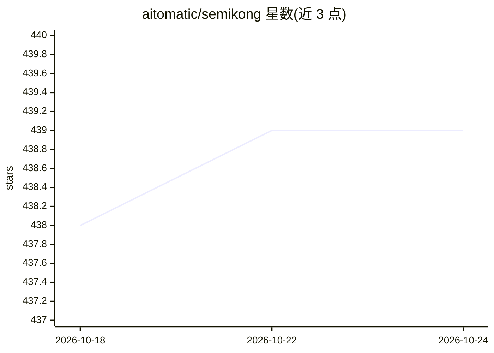

# aitomatic/semikong

⭐ 439 · Python · MIT · 推送 2026-03-18 · [GitHub](https://github.com/aitomatic/semikong) · 组织维护

**面向半导体行业的开源领域语言模型与本体知识图谱项目**

开源半导体 AI 项目，仓库内含两个部分：model/ 目录下的半导体领域语言模型代码与配置（通过 make 命令进行安装、训练和推理实验），以及 ontology/ 目录下的半导体本体与知识图谱模块（RDF/OWL 语义建模、校验与溯源）。项目与 AI Alliance 生态关联，由 Aitomatic、Tokyo Electron、FPT 等机构贡献，被 AI Alliance 描述为其首个领域特定开放模型。仓库代码以 MIT 许可证分发，配有 arXiv 论文（2411.13802）。README 未给出模型权重规模或硬件要求等细节。

## 筛选速览

| 维度 | 判定 | 备注 |
|---|---|---|
| AI 角色 | `ai-native` | 本体是模型或模型工具 |
| 许可风险 | `permissive` | MIT |
| 部署形态 | `None` |  |
| 模型依赖 | — | README 未给出锁定关系 |
| 硬件要求 | — | 无带数字的原话,不猜 |
| 安装摩擦 | `low` | 无编译、无系统依赖或容器化 |
| 成熟度 | `idea` | |

## 能力要点

- 半导体领域语言模型，支持训练与推理实验（make install/train/infer）
- 半导体本体与知识图谱模块（RDF/OWL 语义建模与校验）
- 被 AI Alliance 描述为其首个领域特定开放模型
- 附 arXiv 论文（arXiv:2411.13802）

## 适用场景

- 半导体领域问答、生成与领域 AI 工作流实验
- 基于本体做语义建模、校验与知识图谱工作
- 模型与本体结合构建有领域结构约束的半导体 AI 应用

## 场景标签

`知识图谱` `模型训练` · 领域:知识与检索

## 证据(README 行号)

> L7: - a semiconductor language model in model/
> L14: - a model layer for question answering, generation, and domain-specific AI workflows
> L44: - use the ontology work under `ontology/` for semantic modeling, validation, and knowledge-graph work

## 星数曲线

2026-10-18 438 → 2026-10-24 439（+1）

---
*卡片 v1 · prompt 1.4 · 生成 2026-10-21 · 置信度 high · 依据 README sha `a28f9ba4cb4e` · [字段定义](../../DATASET.md)*
