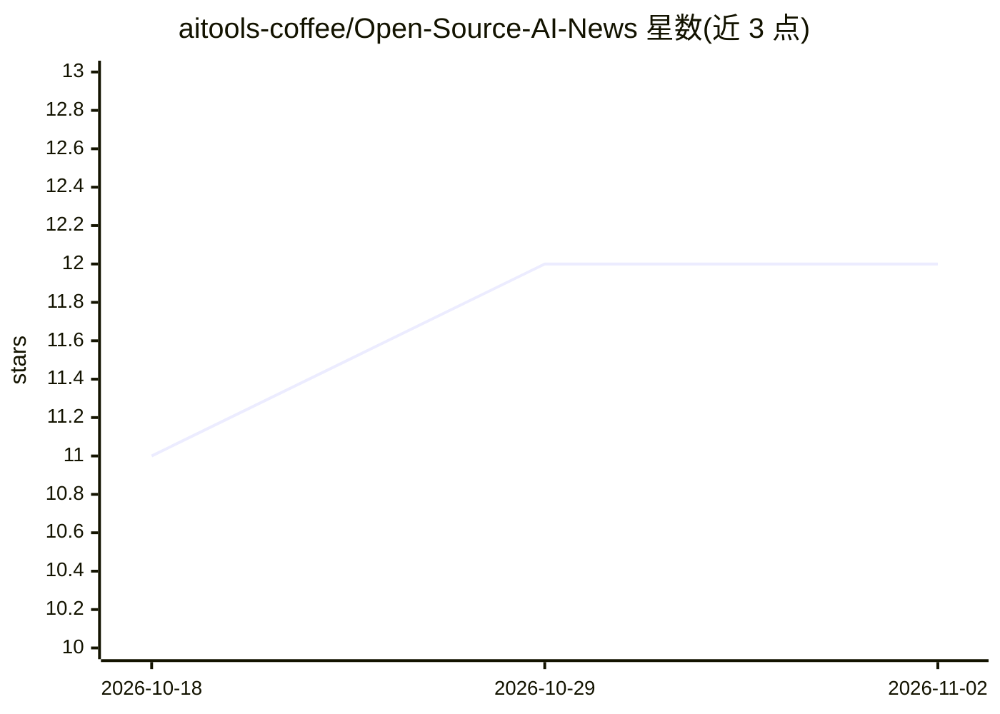

# aitools-coffee/Open-Source-AI-News

⭐ 12 · 推送 2026-02-11 · [GitHub](https://github.com/aitools-coffee/Open-Source-AI-News) · [官网](https://aitools.coffee) · 组织维护

**面向 AI 从业者的 50+ 通讯策展清单，按 7 类组织**

由 AITools.coffee 维护的 AI 通讯（newsletter）聚合清单：收录 50+ 份日报、研究深度分析、开发者工具、数据科学与政策伦理类通讯，按每日简报、工具发现、研究深读、工程与 MLOps、数据科学、商业生产力、政策治理 7 个类别组织，每条含一句话简介。收录标准要求近 3 个月活跃出版、提供原创策划或分析、可免费订阅且非纯推广。清单采用 CC0 许可，每月更新，接受 PR。

## 筛选速览

| 维度 | 判定 | 备注 |
|---|---|---|
| AI 角色 | `ai-knowledge` | 知识聚合/清单类 |
| 许可风险 | `none` | — |
| 部署形态 | `None` |  |
| 模型依赖 | — | README 未给出锁定关系 |
| 硬件要求 | — | 无带数字的原话,不猜 |
| 安装摩擦 | `low` | 无编译、无系统依赖或容器化 |
| 成熟度 | — | 结构信号不足 |

## 能力要点

- 50+ AI 通讯按 7 个类别组织并附简介
- 明确收录标准：活跃出版、原创策展、免费可订
- CC0 许可、每月更新、接受 PR

## 适用场景

- 挑选适合自己关注方向的 AI 新闻通讯
- 按需订阅研究深读或工程/MLOps 类技术通讯
- 了解 AI 政策与伦理治理领域的跟踪渠道

## 场景标签

`精选清单` · 领域:学习与行业

## 证据(README 行号)

> L8: > A curated list of the best AI newsletters, briefings, and technical digests to stay informed about artificial inte
> L16: *Quick-read newsletters delivering the most important AI news to your inbox daily or weekly. Perfect for staying cu

## 星数曲线

2026-10-18 11 → 2026-11-02 12（+1）

---
*卡片 v1 · prompt 1.4 · 生成 2026-11-01 · 置信度 high · 依据 README sha `dba77e8aff63` · [字段定义](../../DATASET.md)*
