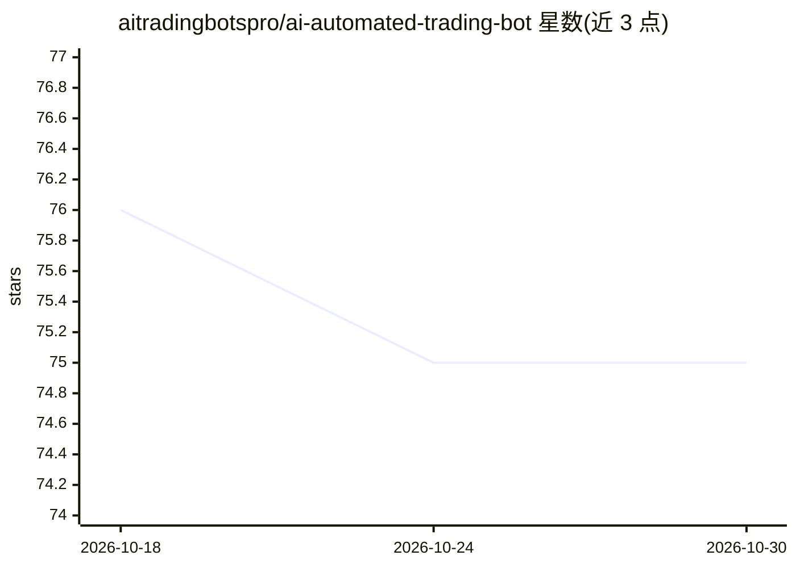

# aitradingbotspro/ai-automated-trading-bot

⭐ 75 · Python · 推送 2026-03-14 · [GitHub](https://github.com/aitradingbotspro/ai-automated-trading-bot) · 个人维护

**接收 TradingView 告警并按风控在交易所下单的 webhook 机器人**

面向手动交易者的 FastAPI webhook 服务：TradingView 告警发送 JSON 到 POST /webhook 后，机器人按固定顺序执行认证/幂等检查、可选 LLM 审查、8 项风控检查（白名单、仓位/杠杆/敞口上限、日亏损限额、冷却、点差过滤），随后在 Binance、Bybit、OKX、Hyperliquid 下市价单并挂 TP/SL 与可选移动止损。AI 为可选层：LLM 顾问、告警增强器、AI 信号生成（OpenAI 兼容接口）。策略本身仍在 TradingView 中，机器人只负责执行。提供 Python 源码运行方式（Python 3.10+，pip 安装依赖），含仪表盘、dry-run 与 testnet 模式。

## 筛选速览

| 维度 | 判定 | 备注 |
|---|---|---|
| AI 角色 | `ai-enhanced` | 去掉 AI 部分产品仍成立 |
| 许可风险 | `none` | — |
| 部署形态 | `library` | 以包/库形式分发 |
| 模型依赖 | — | README 未给出锁定关系 |
| 硬件要求 | — | 无带数字的原话,不猜 |
| 安装摩擦 | `low` | 无编译、无系统依赖或容器化 |
| 成熟度 | — | 结构信号不足 |

## 能力要点

- 一条 webhook 告警接入 Binance/Bybit/OKX/Hyperliquid 四家交易所执行
- 8 项有序风控检查：符号白名单、仓位/敞口/杠杆上限、日亏损限额、冷却、点差过滤
- 可选 AI 层：LLM 订单顾问（批准/拒绝/修改）、告警增强器、AI 信号生成
- 幂等去重、webhook 密钥、限流、dry-run 与 testnet 切换

## 适用场景

- 我把 TradingView 策略告警自动落到交易所，带 TP/SL 和风控限额
- 用 LLM 在下单前二次审查或调整仓位与止损
- 先用 testnet 与 dry-run 模式验证执行流程再上实盘

## 场景标签

`金融量化` · 领域:学习与行业

## 证据(README 行号)

> L50: The bot **does not choose when or what to trade**. Your strategy—entries, exits, indicators—lives in **TradingView*
> L111: |🤖|**AI (optional)** – LLM advisor (approve/modify), alert enhancer, AI signal layer|

## 星数曲线

2026-10-18 76 → 2026-10-30 75（-1）

---
*卡片 v1 · prompt 1.4 · 生成 2026-10-24 · 置信度 high · 依据 README sha `96f6484d4fae` · [字段定义](../../DATASET.md)*
