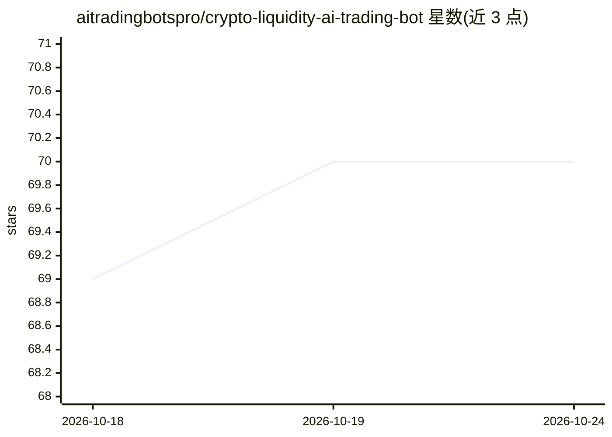

# aitradingbotspro/crypto-liquidity-ai-trading-bot

⭐ 70 · JavaScript · 推送 2026-03-12 · [GitHub](https://github.com/aitradingbotspro/crypto-liquidity-ai-trading-bot) · 个人维护

**加密货币流动性检测与交易信号机器人，覆盖多交易所**

基于订单簿分析的加密货币交易信号工具：扫描盘口深度、缺口、失衡与隐藏大墙，实时检测流动性扫掠与撤墙事件并发出可配置告警；代码分为数据接入（modules/）、分析（trade/）与信号层，可接入自有执行层或用于手动交易。主引擎为 Node（app.js），另提供可选的 Python venv 研究环境；兼容 Binance、Bybit、Kraken、OKX 等交易所 REST/WS API。README 附 2024 年历史回测指标，并声明回测结果受手续费、滑点与执行延迟影响。

## 筛选速览

| 维度 | 判定 | 备注 |
|---|---|---|
| AI 角色 | `ai-native` | 本体是模型或模型工具 |
| 许可风险 | `none` | — |
| 部署形态 | `library` | 以包/库形式分发 |
| 模型依赖 | — | README 未给出锁定关系 |
| 硬件要求 | — | 无带数字的原话,不猜 |
| 安装摩擦 | `low` | 无编译、无系统依赖或容器化 |
| 成熟度 | — | 结构信号不足 |

## 能力要点

- 订单簿扫描：深度、缺口、失衡检测
- 隐藏买卖大墙与流动性扫掠实时检测
- 多交易所接入（Binance/Bybit/Kraken/OKX 等 REST/WS）
- Node 主引擎 + 可选 Python 研究环境，模块化可扩展执行层

## 适用场景

- 把流动性事件信号接入自己的执行引擎做算法交易
- 量化研究：订单簿与市场微观结构分析
- 手动交易时接收流动性扫掠与订单簿真空告警

## 场景标签

`金融量化` · 领域:学习与行业

## 证据(README 行号)

> L3: **AI trading bot** for liquidity detection and algorithmic trading in crypto markets. Detect order book gaps, hidden
> L137: 2. **Detect** liquidity sweeps and wall removals in real time.
> L208: - **AI/ML strategy dev** — Use liquidity events as features or triggers.

## 星数曲线

2026-10-18 69 → 2026-10-24 70（+1）

---
*卡片 v1 · prompt 1.4 · 生成 2026-10-24 · 置信度 low · 依据 README sha `f123d5230f1d` · [字段定义](../../DATASET.md)*
