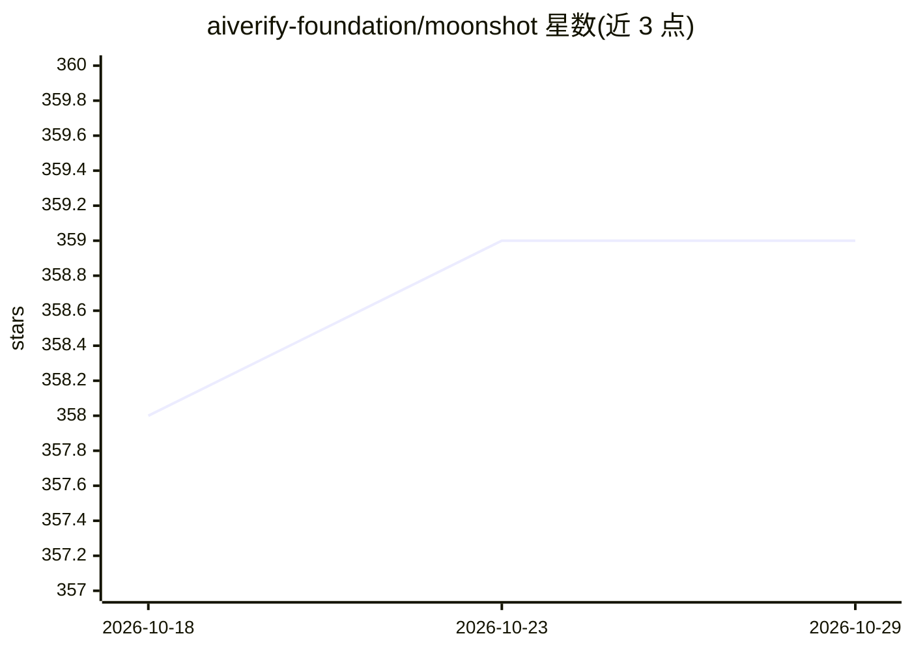

# aiverify-foundation/moonshot

⭐ 359 · Python · Apache-2.0 · 推送 2026-06-10 · [GitHub](https://github.com/aiverify-foundation/moonshot) · [官网](https://aiverify-foundation.github.io/moonshot/) · 组织维护

**面向 LLM 应用与模型的基准评测与红队测试工具**

AI Verify Foundation 开发的评测工具，将基准测试与红队攻击整合到统一平台：使用开源基准数据集与指标测试 LLM 应用的性能与可信安全风险（偏见、毒性、幻觉等），并通过算法策略或生成式 LLM 自动生成对抗性提示以发现漏洞。支持 Web UI、交互式 CLI、Library API 与 Web API 四种使用方式，可接入 MLOps 流程；用户可自定义数据集、评测指标与评分标准构建 Recipe，输出含交互图表的 HTML 报告。当前处于 beta 阶段，需 Python 3.11，Web UI 需 Node.js 20.11.1 以上。

## 筛选速览

| 维度 | 判定 | 备注 |
|---|---|---|
| AI 角色 | `ai-ecosystem` | LLM/agent 周边工具 |
| 许可风险 | `permissive` | Apache-2.0 |
| 部署形态 | `library` | 以包/库形式分发 |
| 模型依赖 | — | README 未给出锁定关系 |
| 硬件要求 | — | 无带数字的原话,不猜 |
| 安装摩擦 | `low` | 无编译、无系统依赖或容器化 |
| 成熟度 | `idea` | |

## 能力要点

- 基准测试覆盖性能与信任安全（偏见/毒性/幻觉）及 IMDA Starter Kit 工作流
- 红队攻击：算法策略或生成式 LLM 生成对抗性提示
- 提供 Web UI、交互式 CLI、Library API 与 Web API 多种接口
- 自定义 Recipe（数据集/提示模板/指标/评分）与 HTML 交互式报告

## 适用场景

- 上线前对我的 LLM 应用做信任与安全基准测试
- 对 LLM 应用做红队攻击找出误用与漏洞场景
- 把评测流程集成进 MLOps 工作流自动化执行

## 场景标签

`模型评测` · 领域:评测与运维

## 证据(README 行号)

> L11: Developed by the AI Verify Foundation, Moonshot is a tool to bring Benchmarking and Red-Teaming together to help AI
> L16: - Benchmark Tests: Systematically test LLM Apps or LLMs across critical trust & safety risks using a wide array of 
> L17: - Red Team Attacks: Proactively identify vulnerabilities and potential misuse scenarios in your LLM applications th

## 星数曲线

2026-10-18 358 → 2026-10-29 359（+1）

---
*卡片 v1 · prompt 1.4 · 生成 2026-10-22 · 置信度 high · 依据 README sha `3295ce4ac5ba` · [字段定义](../../DATASET.md)*
