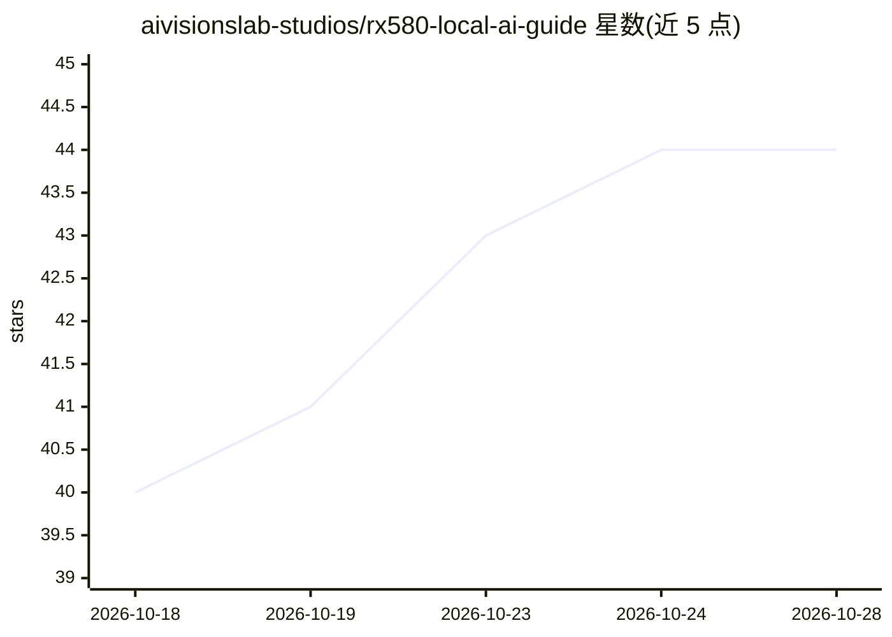

# aivisionslab-studios/rx580-local-ai-guide

⭐ 44 · TypeScript · MIT · 推送 2026-06-23 · [GitHub](https://github.com/aivisionslab-studios/rx580-local-ai-guide) · [官网](https://setup-ia-local-rx580-vulkan.web.app) · 组织维护

**AMD RX 580 8GB 上用 Vulkan 跑本地 AI 的完整指南**

面向持有 AMD RX 580（Polaris/GCN4）旧卡用户的技术指南仓库，记录在无 CUDA/ROCm 条件下从源码编译 llama.cpp、stable-diffusion.cpp、whisper.cpp 并以 Vulkan 后端运行 LLM、Stable Diffusion、FLUX 混合推理与语音转录的完整流程。核心机制为 GPU/CPU 双路径路由：8GB VRAM 内的工作负载走 Vulkan，16GB 级模型（FLUX）将 T5XXL/VAE 卸载到 32GB RAM。同时记录 DirectML/ROCm/OpenVINO 等失败路径及原因。限制：需自行编译，WSL2 下 Vulkan 不可用于该 GPU。

## 筛选速览

| 维度 | 判定 | 备注 |
|---|---|---|
| AI 角色 | `ai-knowledge` | 知识聚合/清单类 |
| 许可风险 | `permissive` | MIT |
| 部署形态 | `desktop` | 安装包/桌面程序 |
| 模型依赖 | local-ok | 支持本地模型 |
| 硬件要求 | — | 无带数字的原话,不猜 |
| 安装摩擦 | `low` | 无编译、无系统依赖或容器化 |
| 成熟度 | — | 结构信号不足 |

## 能力要点

- Vulkan 后端编译 llama.cpp/stable-diffusion.cpp/whisper.cpp 的完整步骤与命令
- GPU/CPU 双路径内存路由方案（FLUX 16GB 模型在 8GB 卡上运行）
- DirectML/ROCm/OpenVINO 等失败路径的错误日志与根因记录
- Windows 与 Linux 原生（Mesa RADV）两种环境的基准数据

## 适用场景

- 用闲置的 RX 580 搭建本地 LLM 推理与聊天界面（OpenWebUI）
- 在 8GB 老卡上运行 SD 1.5 出图与 FLUX 混合推理
- 在 AMD 旧卡上做 Vulkan 加速的 Whisper 音频转录

## 场景标签

`推理引擎` `图像生成` `语音识别` `教程课程` · 领域:内容生成

## 证据(README 行号)

> L27: By compiling `llama.cpp` and `stable-diffusion.cpp` from source with Vulkan support, the RX 580 runs real, useful A
> L30: RX 580 8GB  ──►  Vulkan API  ──►  ggml engine  ──►  17 tok/s LLM  +  72s/image SD
> L115: ## Quick Start: LLM via Vulkan (Windows)

## 星数曲线

2026-10-18 40 → 2026-10-28 44（+4）

---
*卡片 v1 · prompt 1.4 · 生成 2026-10-25 · 置信度 high · 依据 README sha `054a52de2fef` · [字段定义](../../DATASET.md)*
