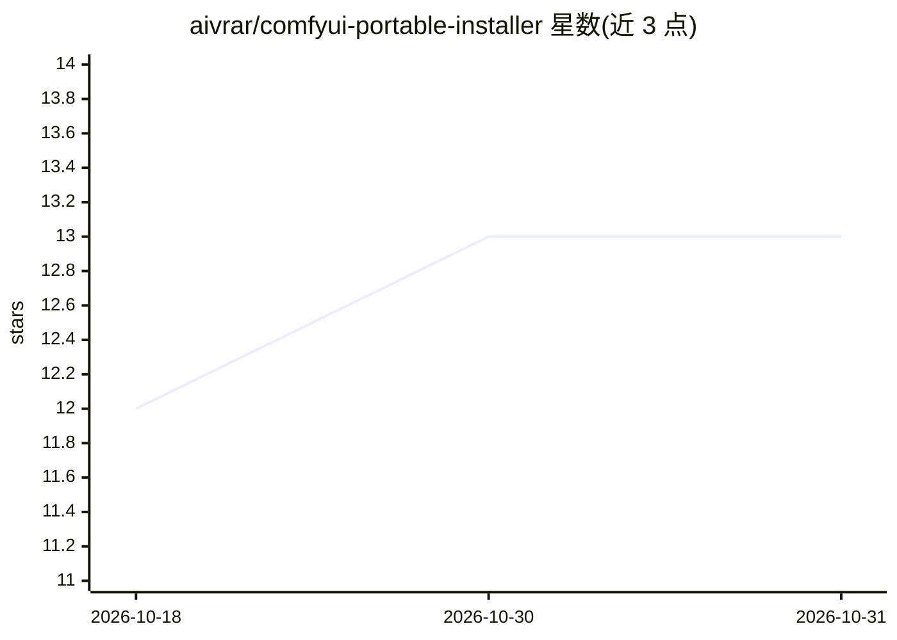

# aivrar/comfyui-portable-installer

⭐ 13 · Python · MIT · 推送 2026-04-26 · [GitHub](https://github.com/aivrar/comfyui-portable-installer) · [官网](https://github.com/aivrar/comfyui-portable-installer) · 个人维护

**Windows 一键便携安装 ComfyUI 的安装器与管理 GUI**

面向 Windows 10/11 用户的一键便携式 ComfyUI 安装工具：双击 install.bat 即自动下载 Python、MinGit、FFmpeg、PyTorch（cu128）与 ComfyUI 至单一文件夹，无需 Docker、系统 Python、Git、CUDA 工具链或管理员权限，文件夹可整体迁移。附带管理 GUI，支持 NVIDIA 多 GPU 多实例并行（最多 8 个实例）、按显存档位推荐下载 101 个预置模型、16 个精选自定义节点与 SageAttention 一键安装，并提供 48 方法 REST API 客户端供程序化调用。仅限 Windows 平台。

## 筛选速览

| 维度 | 判定 | 备注 |
|---|---|---|
| AI 角色 | `ai-ecosystem` | LLM/agent 周边工具 |
| 许可风险 | `permissive` | MIT |
| 部署形态 | `self-host` | docker 或自建部署 |
| 模型依赖 | — | README 未给出锁定关系 |
| 硬件要求 | — | 无带数字的原话,不猜 |
| 安装摩擦 | `low` | 无编译、无系统依赖或容器化 |
| 成熟度 | — | 结构信号不足 |

## 能力要点

- 单文件夹便携安装，自动下载全部组件，删除文件夹即卸载
- 多 GPU 多实例管理（每 GPU 独立实例、端口与 VRAM 模式，最多 8 个）
- 101 个预置模型按显存档位推荐，从 HuggingFace 一键下载
- 48 方法 REST API 客户端与 WebSocket 进度支持

## 适用场景

- 在干净 Windows 机器上零依赖安装并运行 ComfyUI
- 多张 NVIDIA GPU 并行跑多个生图/生视频工作流
- 新手按显存档位挑选并下载合适模型

## 场景标签

`图像生成` · 领域:内容生成

## 证据(README 行号)

> L7: Drop this folder on any Windows 10/11 machine, double-click `install.bat`, and walk away. When it's done you have a 
> L63: |ComfyUI|Latest|Comfy-Org/ComfyUI|The image/video generation engine|

## 星数曲线

2026-10-18 12 → 2026-10-31 13（+1）

---
*卡片 v1 · prompt 1.4 · 生成 2026-10-31 · 置信度 mid · 依据 README sha `12d0aa540e3a` · [字段定义](../../DATASET.md)*
