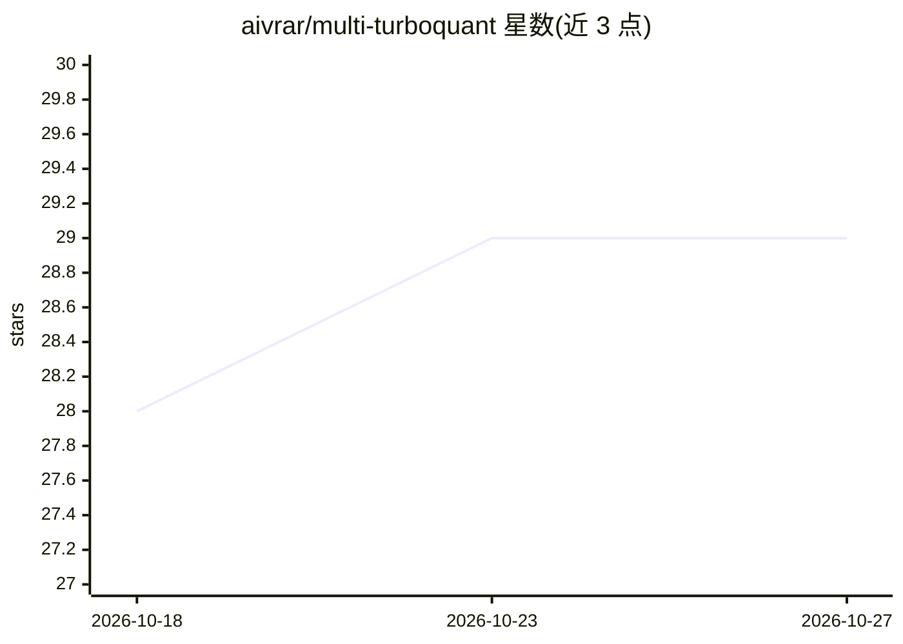

# aivrar/multi-turboquant

⭐ 29 · Python · MIT · 推送 2026-10-10 · [GitHub](https://github.com/aivrar/multi-turboquant) · 个人维护

**LLM 推理 KV cache 压缩工具包：12 种压缩方法统一 API**

面向 LLM 推理基础设施的 Python 工具包：针对推理时占用大量显存的 KV cache，提供 12 种 Python 原生压缩方法（TurboQuant/TCQ/IsoQuant/PlanarQuant/RotorQuant/TriAttention 等，含约 80x 组合压缩模式），统一 API 并支持 19 个预设，可生成 llama.cpp 或 vLLM 启动命令。附带浏览器 Web UI 用于查看 GPU、基准测试与部署规划。可选运行时（FastDMS、FlashAttention、LMCache、MInference、SageAttention、TriAttention 校准器）通过 mtq-env 隔离管理；另有 Godzilla KVarN 后端、CUDA 权重共享与多 GPU 规划工作流。方法在 RTX 3090 上验证，rotor4 标注为实验性。

## 筛选速览

| 维度 | 判定 | 备注 |
|---|---|---|
| AI 角色 | `ai-ecosystem` | LLM/agent 周边工具 |
| 许可风险 | `permissive` | MIT |
| 部署形态 | `desktop` | 安装包/桌面程序 |
| 模型依赖 | — | README 未给出锁定关系 |
| 硬件要求 | — | 无带数字的原话,不猜 |
| 安装摩擦 | `high` | 编译与系统依赖俱全 |
| 成熟度 | `idea` | |

## 能力要点

- 12 种 KV cache 压缩方法（2.25-16 bit，3.6-16x 压缩比）统一 API
- 组合模式：token 驱逐 + 量化，约 80x 总 KV 缩减
- 生成带最优压缩参数的 llama.cpp/vLLM 启动命令
- mtq-env 隔离管理可选 add-on 的锁定 uv 环境；Web UI 含 GPU 检测与基准测试

## 适用场景

- 本地或部署环境压缩 32B 级模型的 KV cache 显存占用
- 为 llama.cpp/vLLM 生成带压缩配置的启动命令
- 在 Web UI 中对比 12 种压缩方法并规划多 GPU 部署
- 为 Godzilla llama.cpp 运行时做 KVarN/TriAttention 校准与构建

## 场景标签

`模型量化` · 领域:训练与推理

## 证据(README 行号)

> L22: A Python toolkit that compresses the KV cache in large language models. The KV cache is the #1 memory bottleneck du
> L24: Install it, pick a preset, and get the exact launch command for llama.cpp or vLLM with optimal compression. Or use 

## 星数曲线

2026-10-18 28 → 2026-10-27 29（+1）

---
*卡片 v1 · prompt 1.4 · 生成 2026-10-26 · 置信度 mid · 依据 README sha `d6c8496ae250` · [字段定义](../../DATASET.md)*
