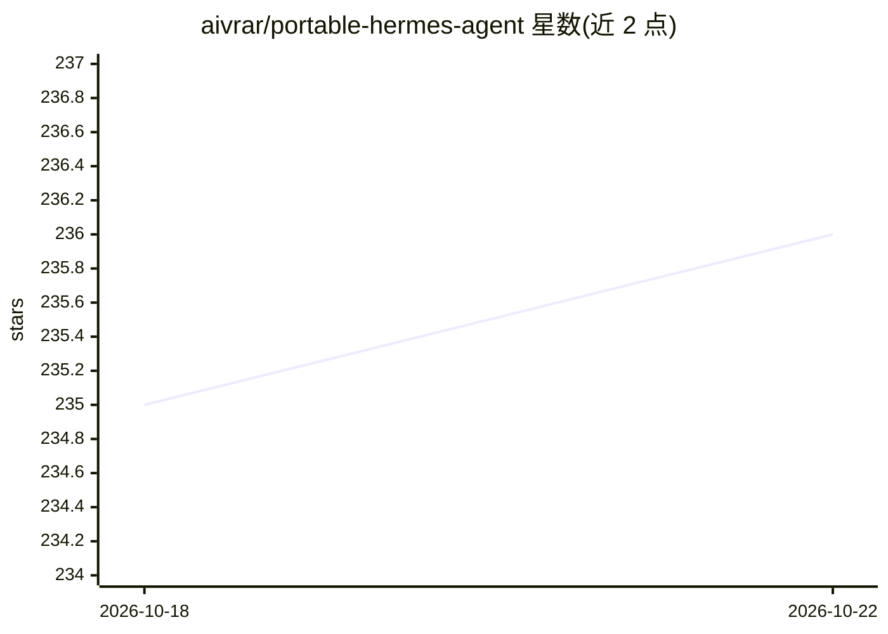

# aivrar/portable-hermes-agent

⭐ 236 · Python · MIT · 推送 2026-10-21 · [GitHub](https://github.com/aivrar/portable-hermes-agent) · [官网](https://github.com/aivrar/portable-hermes-agent/releases/latest) · 个人维护 · 中文 README

**Windows 便携 AI agent 桌面应用：100 工具、GUI、本地/云端模型**

基于 NousResearch/hermes-agent 的便携式 Windows 桌面 AI agent，面向非技术用户：Tkinter 暗色 GUI、多语言界面、图像附件与 API key 向导。提供 20+ 工具集共 100 个工具，覆盖 LM Studio 模型管理、TTS（10 语音模型/克隆）、音乐生成、ComfyUI 图像生成、工作流引擎与运行时工具制作器。本地模型经 LM Studio（需 NVIDIA GPU 8GB+），云端经 OpenRouter；无 API key 时可用内置 1,054 行指南的引导模式。免安装、免 Docker、免管理员权限，首启自动下载内嵌 Python 与依赖。

## 筛选速览

| 维度 | 判定 | 备注 |
|---|---|---|
| AI 角色 | `ai-native` | 本体是模型或模型工具 |
| 许可风险 | `permissive` | MIT |
| 部署形态 | `desktop` | 安装包/桌面程序 |
| 模型依赖 | locked-api |  |
| 硬件要求 | — | 无带数字的原话,不猜 |
| 安装摩擦 | `low` | 无编译、无系统依赖或容器化 |
| 成熟度 | — | 结构信号不足 |

## 能力要点

- 100 个工具 / 20+ 工具集（LM Studio、TTS、音乐、ComfyUI、工作流、工具制作器）
- 免安装免管理员权限：发布 ZIP 解压后运行 START.bat，自动下载内嵌 Python 与 Node.js
- 本地模型经 LM Studio，云端经 OpenRouter，支持模型切换
- 无 API key 的引导模式与内置可搜索用户手册

## 适用场景

- 在 Windows 上免安装运行带 GUI 的本地/云端 AI agent
- 用自然语言驱动的工具完成搜索、文件操作、语音合成与图像生成
- 把工具调用串成带定时调度的自动化工作流
- 运行时动态创建 REST API 包装或 Python 处理器工具

## 场景标签

`AI 助手` `工作流自动化` `图像生成` `语音合成` · 领域:效率与自动化

## 证据(README 行号)

> L9: **Portable AI agent desktop for Windows** — 100 tools, GUI, local models via LM Studio, TTS, Music, ComfyUI, workflo
> L11: Built on NousResearch/hermes-agent (MIT License) with extensive customization for non-technical users.
> L27: |**LM Studio**|10|Load/unload models, search HuggingFace, tokenize, embed, direct chat, API key management, model l

## 星数曲线

2026-10-18 235 → 2026-10-22 236（+1）

---
*卡片 v1 · prompt 1.4 · 生成 2026-10-22 · 置信度 high · 依据 README sha `f825a5486ec6` · [字段定义](../../DATASET.md)*
