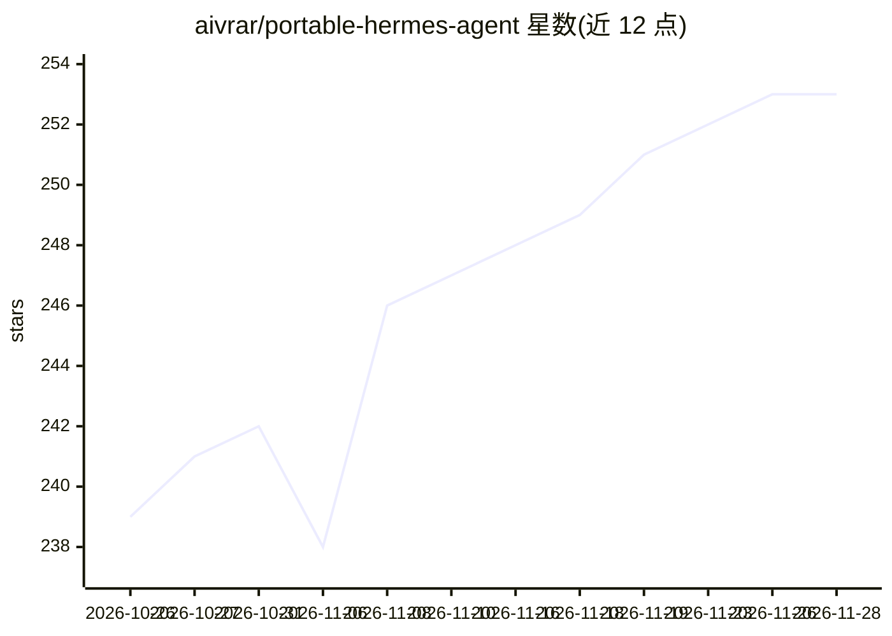

# aivrar/portable-hermes-agent

⭐ 253 · Python · MIT · 推送 2026-11-19 · [GitHub](https://github.com/aivrar/portable-hermes-agent) · [官网](https://github.com/aivrar/portable-hermes-agent/releases/latest) · 个人维护 · 中文 README

**把 Hermes Agent 打包成 Windows 免安装桌面 AI agent**

将 NousResearch/hermes-agent（MIT）打包为 Windows 便携包：解压后双击 START.bat 即可使用，无需安装 Python、Docker 或管理员权限；首次启动自动下载嵌入式 Python 3.14 与上游核心。桌面 GUI 提供 100 个工具、会话管理、权限面板、多语言界面；通过 OpenRouter API key 或 LM Studio 面板连接本地 GPU 模型。附带 TTS、音乐、ComfyUI 图像三个可移植生成服务器扩展、工作流引擎与运行时工具创建器。更新分 wrapper 与 core 两部分，均带哈希校验与回滚。

## 筛选速览

| 维度 | 判定 | 备注 |
|---|---|---|
| AI 角色 | `ai-native` | 本体是模型或模型工具 |
| 许可风险 | `permissive` | MIT |
| 部署形态 | `desktop` | 安装包/桌面程序 |
| 模型依赖 | — | README 未给出锁定关系 |
| 硬件要求 | — | 无带数字的原话,不猜 |
| 安装摩擦 | `low` | 无编译、无系统依赖或容器化 |
| 成熟度 | — | 结构信号不足 |

## 能力要点

- 免安装便携包：解压双击 START.bat，无 Docker、无管理员权限
- 100 个工具覆盖 20+ 工具集（LM Studio、TTS、音乐、ComfyUI、工作流等）
- 本地模型支持：LM Studio 面板可选单卡、多卡或内存加载
- 运行时 Tool Maker：动态封装 REST API 或自定义 Python 工具

## 适用场景

- 在 Windows 上零配置使用带工具调用的 AI agent
- 用自己的 GPU 通过 LM Studio 跑本地模型聊天
- 无 API key 时用内置离线引导学习配置第一个模型
- 用工作流引擎编排多步自动化任务

## 场景标签

`工作流自动化` `图像生成` `语音合成` · 领域:效率与自动化

## 证据(README 行号)

> L9:  An AI agent with a desktop app, in one folder, for Windows.
> L25: Portable Hermes Agent is NousResearch/hermes-agent (MIT License) packaged for people who do not want to set up Pyth
> L31: 3. **Connect a model.** Paste a free OpenRouter key in the setup wizard, or open **Tools > LM Studio** to use a mod

## 星数曲线

2026-10-26 239 → 2026-11-28 253（+14）

---
*卡片 v1 · prompt 1.4 · 生成 2026-11-25 · 置信度 high · 依据 README sha `9dbfa3050b20` · [字段定义](../../DATASET.md)*
