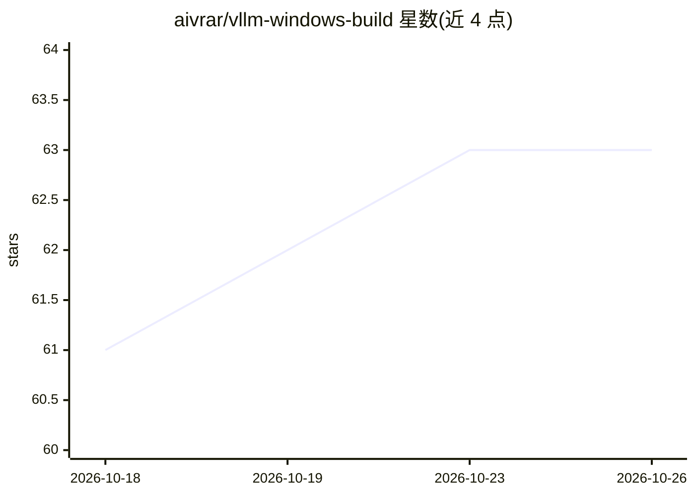

# aivrar/vllm-windows-build

⭐ 63 · Python · MIT · 推送 2026-10-10 · [GitHub](https://github.com/aivrar/vllm-windows-build) · [官网](https://github.com/aivrar/vllm-windows-build/wiki) · 个人维护

**vLLM 的原生 Windows 预编译构建与安装器：无需 WSL/Docker**

为 Windows 提供 vLLM 的原生 MSVC 构建产物：可下载安装的预编译 wheel、便携安装器（install.bat/launch.bat），以及从源码自行编译的补丁集与构建流程。覆盖 vLLM 0.14.2–0.29.0 多个版本，含 CUDA 12.8/13.0/13.2、PyTorch 2.13、FlashAttention 2、Rust 前端与工具解析器、10 种 KV 缓存压缩方法（Multi-TurboQuant 6 种+上游 TurboQuant 4 种）及可选的 CPU/文件系统 KV 卸载。支持 SM 7.5–12.0（RTX 20xx 至 50 系），原生 Blackwell FP4 不支持，部分 SM120 CUTLASS 入口因 MSVC ABI 限制被省略。

## 筛选速览

| 维度 | 判定 | 备注 |
|---|---|---|
| AI 角色 | `ai-ecosystem` | LLM/agent 周边工具 |
| 许可风险 | `permissive` | MIT |
| 部署形态 | `desktop` | 安装包/桌面程序 |
| 模型依赖 | local-ok | 支持本地模型 |
| 硬件要求 | `gpu-8g` | |
| 安装摩擦 | `high` | 编译与系统依赖俱全 |
| 成熟度 | — | 结构信号不足 |

## 能力要点

- 原生 Windows 构建，无需 WSL/Docker/Linux 虚拟机
- 预编译 wheel（239 MB，含 SHA-256 校验）与便携安装器，附源码构建补丁
- 10 种 KV 缓存压缩方法与可选 CPU/文件系统 KV 卸载
- 覆盖 RTX 20xx/30xx/40xx/50xx（SM 7.5–12.0）内核，Turing 提供 --turing-compat 兼容配置

## 适用场景

- 在 Windows 上直接运行 vLLM 提供 OpenAI 兼容推理服务，不装 WSL 或 Docker
- 用 Qwen3 系列 GPTQ/AWQ 量化模型在消费级 RTX 显卡上部署
- 借助 KV 缓存压缩与 CPU/NVMe 卸载在有限显存下跑长上下文
- 需要自行编译时，使用仓库提供的源码补丁与构建流程

## 场景标签

`推理引擎` · 领域:训练与推理

## 证据(README 行号)

> L54: **Native Windows build of vLLM 0.27.1 - no WSL, no Docker, no Linux VM.**
> L67: vLLM is the most popular open-source LLM serving engine, but it
> L68: officially only supports Linux. This repo provides a **pre-built wheel**

## 星数曲线

2026-10-18 61 → 2026-10-26 63（+2）

---
*卡片 v1 · prompt 1.4 · 生成 2026-10-24 · 置信度 mid · 依据 README sha `361c22125345` · [字段定义](../../DATASET.md)*
