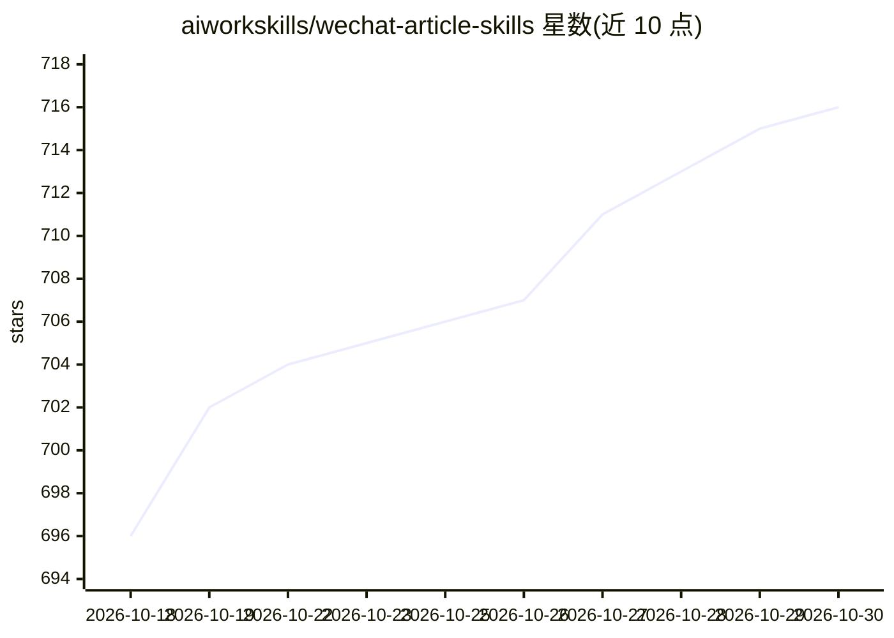

# aiworkskills/wechat-article-skills

⭐ 716 · Python · Apache-2.0 · 推送 2026-09-23 · [GitHub](https://github.com/aiworkskills/wechat-article-skills) · [官网](https://aiworkskills.cn) · 组织维护 · 中文 README

**微信公众号 AI 运营技能包：选题到发文全流程技能**

一套开源的 AI Agent 技能包（9 个 Skill），装进支持 Skills 的 AI 工具（OpenClaw/Claw 系列、Claude Code、Cursor、Codex 等）后，以自然语言驱动公众号运营全流程：选题卡片、按文风规范写稿、敏感词/错别字/AI 味审稿、Markdown 转微信 HTML 排版（8 模版×3 配色+9 版式组件）、封面与正文配图、微信 API 直发草稿箱。每步暂停等确认，不支持无人值守。写稿与配图模型 API 可选，走 OpenAI 兼容接口，Key 仅本地存储；需 Python 3.10+ 与 PyYAML。

## 筛选速览

| 维度 | 判定 | 备注 |
|---|---|---|
| AI 角色 | `ai-ecosystem` | LLM/agent 周边工具 |
| 许可风险 | `permissive` | Apache-2.0 |
| 部署形态 | `None` |  |
| 模型依赖 | — | README 未给出锁定关系 |
| 硬件要求 | — | 无带数字的原话,不猜 |
| 安装摩擦 | `low` | 无编译、无系统依赖或容器化 |
| 成熟度 | — | 结构信号不足 |

## 能力要点

- 9 个 Skill 覆盖选题→写稿→审稿→排版→配图→发布全流程，每步暂停等确认
- 兼容 13+ Claw 系列工具及 Claude Code / Cursor / Codex，克隆仓库即可读取 skills/
- 排版为 8 套模版×3 配色，另有 9 个 ::: 版式组件；封面 12 形态、正文配图 8 形态
- 写稿与配图模型可选配置，走 OpenAI 兼容接口，API Key 仅存本地

## 适用场景

- 个人或团队运营公众号时让 AI 接管重复的写稿排版环节
- 把文章排版成微信 HTML 并生成带标题的成品封面
- 按自己的文风规范批量产出并审校公众号内容，经确认后发进草稿箱

## 场景标签

`AI 写作` `图像生成` · 领域:内容生成

## 证据(README 行号)

> L28: **wechat-article-skills** 是一套开源的**微信公众号 AI 运营技能包**（AI Agent Skills）。装进你已经在用的 AI 工具后，用自然语言就能跑完公众号从选题到发布的全流程。
> L33: - **需要什么**：一个支持 Skills 的 AI 工具（Claude Code / Cursor / Codex / OpenClaw / Claw 系列 13+ 任选其一）+ Python 3.10+。写稿和配图的大模型 

## 星数曲线

2026-10-18 696 → 2026-10-30 716（+20）

---
*卡片 v1 · prompt 1.4 · 生成 2026-10-21 · 置信度 high · 依据 README sha `bc5607b0e77e` · [字段定义](../../DATASET.md)*
