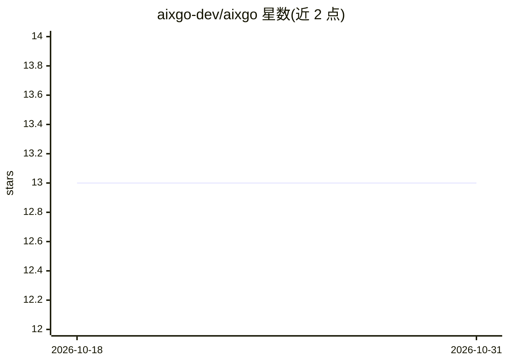

# aixgo-dev/aixgo

⭐ 13 · Go · MIT · 推送 2026-10-26 · [GitHub](https://github.com/aixgo-dev/aixgo) · 组织维护

**Go 语言的厂商中立多智能体编排框架，YAML 定义拓扑**

面向 Go 开发者的多智能体编排框架：用 YAML 声明 agent 拓扑与编排模式，编译为单个 <20MB 二进制运行，冷启动声明低于 100ms。通过统一接口接入 8+ 个 LLM 提供商（OpenAI/Anthropic/Gemini/xAI/Vertex/Bedrock/HuggingFace，及 Ollama、vLLM 推理服务），按模型名自动选择提供商。内置 6 种 agent 类型、13 种编排模式、MCP 工具调用、会话持久化（JSONL/Redis）、4 种认证模式、SSRF 防护与 OpenTelemetry/Prometheus/Langfuse 观测。MIT 许可。

## 筛选速览

| 维度 | 判定 | 备注 |
|---|---|---|
| AI 角色 | `ai-ecosystem` | LLM/agent 周边工具 |
| 许可风险 | `permissive` | MIT |
| 部署形态 | `library` | 以包/库形式分发 |
| 模型依赖 | local-ok | 支持本地模型 |
| 硬件要求 | — | 无带数字的原话,不猜 |
| 安装摩擦 | `low` | 无编译、无系统依赖或容器化 |
| 成熟度 | — | 结构信号不足 |

## 能力要点

- YAML 声明式 agent 拓扑，切换模型为单行配置变更
- 8+ LLM 提供商统一接口，按模型名自动路由
- 13 种编排模式与 6 种 agent 类型
- 内置认证、限流、SSRF 防护、OpenTelemetry 与成本追踪

## 适用场景

- 在 Go 服务中以配置方式构建多 agent 工作流
- 跨多个 LLM 提供商路由以优化成本
- 在 Kubernetes/Terraform 环境中以声明式配置交付 agent 系统

## 场景标签

`多智能体` `Agent 框架` `模型网关` · 领域:Agent 开发

## 证据(README 行号)

> L3: Vendor-neutral, config-driven multi-agent orchestration for Go. Define agent topologies in YAML, run them as a singl
> L70: - **8+ LLM providers** — OpenAI, Anthropic, Gemini, xAI, Vertex AI, Amazon Bedrock, HuggingFace, plus inference ser

## 星数曲线

2026-10-18 13 → 2026-10-31 13（+0）

---
*卡片 v1 · prompt 1.4 · 生成 2026-10-31 · 置信度 high · 依据 README sha `94d89c66ba34` · [字段定义](../../DATASET.md)*
