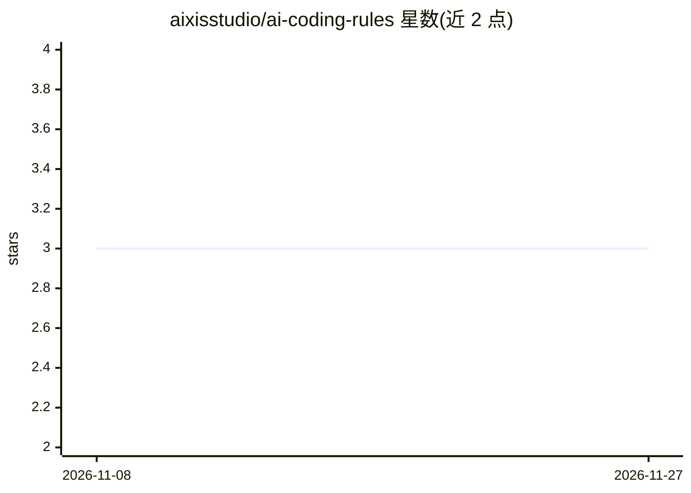

# aixisstudio/ai-coding-rules

⭐ 3 · MIT · 推送 2026-11-25 · [GitHub](https://github.com/aixisstudio/ai-coding-rules) · [官网](https://aixisstudio.github.io/ai-coding-rules/) · 组织维护

**为 AI 编码工具提供项目级规则文件合集与模板**

收录让 AI 编码工具理解代码库的项目级配置文件：CLAUDE.md、.cursor/rules、AGENTS.md、.windsurfrules、copilot-instructions.md 等，按工具与按技术栈（Python/FastAPI、TypeScript/Next.js、Rust CLI、Go、React/Vite）两条线索组织为可直接套用的模板。附社区验证过的规则撰写要点：命令区块、负面约束清单、按域拆分并配 glob、引用真实文件而非粘贴、控制在 150 行以内。MIT 许可，由 aixisstudio 维护。

## 筛选速览

| 维度 | 判定 | 备注 |
|---|---|---|
| AI 角色 | `ai-knowledge` | 知识聚合/清单类 |
| 许可风险 | `permissive` | MIT |
| 部署形态 | `None` |  |
| 模型依赖 | — | README 未给出锁定关系 |
| 硬件要求 | — | 无带数字的原话,不猜 |
| 安装摩擦 | `low` | 无编译、无系统依赖或容器化 |
| 成熟度 | — | 结构信号不足 |

## 能力要点

- 按工具索引 8 类 AI 编码工具的规则文件及其加载方式
- 提供 5 个技术栈即用模板（Python/TS/Rust/Go/React）
- 给出 5 条社区验证的规则文件撰写方法
- 多语言 README（英/法/西/中/日/俄）

## 适用场景

- 给新项目快速配一套 Cursor/Claude Code 规则文件
- 按技术栈挑选现成模板改造成团队规范
- 了解各类 AI 编码工具读取规则文件的路径约定

## 场景标签

`提示工程` · 领域:Agent 开发

## 证据(README 行号)

> L9: The dotfiles of the AI era: **`CLAUDE.md`, `.cursor/rules`, `AGENTS.md`, `.windsurfrules`, `.github/copilot-instruct
> L26: ### By stack — ready-made templates

## 星数曲线

2026-11-08 3 → 2026-11-27 3（+0）

---
*卡片 v1 · prompt 1.4 · 生成 2026-11-27 · 置信度 high · 依据 README sha `d877241e36a5` · [字段定义](../../DATASET.md)*
