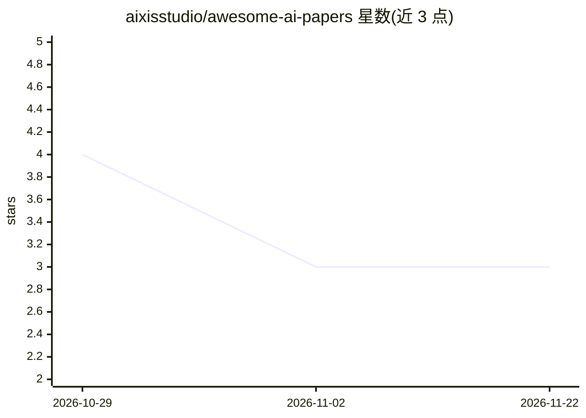

# aixisstudio/awesome-ai-papers

⭐ 3 · MIT · 推送 2026-10-30 · [GitHub](https://github.com/aixisstudio/awesome-ai-papers) · 组织维护

**AI 经典论文清单：用一句话讲清每篇必读论文**

一个按主题组织的 AI 论文聚合清单，覆盖 Transformers 时代、现代 LLM、检索与 Agent、效率优化四个板块，每条条目附一句话要点说明，并给出快速读论文的方法建议、扩展的经典论文表格（含选读理由）以及 arXiv、Papers with Code、HuggingFace Papers 等论文跟踪渠道。采用 MIT 许可，支持多语言切换，由 aixisstudio 维护。

## 筛选速览

| 维度 | 判定 | 备注 |
|---|---|---|
| AI 角色 | `ai-knowledge` | 知识聚合/清单类 |
| 许可风险 | `permissive` | MIT |
| 部署形态 | `None` |  |
| 模型依赖 | — | README 未给出锁定关系 |
| 硬件要求 | — | 无带数字的原话,不猜 |
| 安装摩擦 | `low` | 无编译、无系统依赖或容器化 |
| 成熟度 | — | 结构信号不足 |

## 能力要点

- 按 Transformers/现代 LLM/检索与 Agent/效率分类组织必读论文
- 每篇论文附一句话核心机制说明
- 附快速阅读论文的方法（摘要→图→结论→方法略读）
- 多语言版本（英/法/西/中/日/俄）

## 适用场景

- 入门者快速了解 Transformer、RLHF、RAG 等经典工作脉络
- 查找跟进 AI 论文的渠道与社区
- 检索某类主题（如效率优化）的代表论文

## 场景标签

`精选清单` · 领域:学习与行业

## 证据(README 行号)

> L1: # Awesome Ai Papers
> L7: ## 📜 Must-reads, explained simply
> L32: ## 🎓 How to read a paper (fast)

## 星数曲线

2026-10-29 4 → 2026-11-22 3（-1）

---
*卡片 v1 · prompt 1.4 · 生成 2026-11-22 · 置信度 high · 依据 README sha `5cd518d165a0` · [字段定义](../../DATASET.md)*
