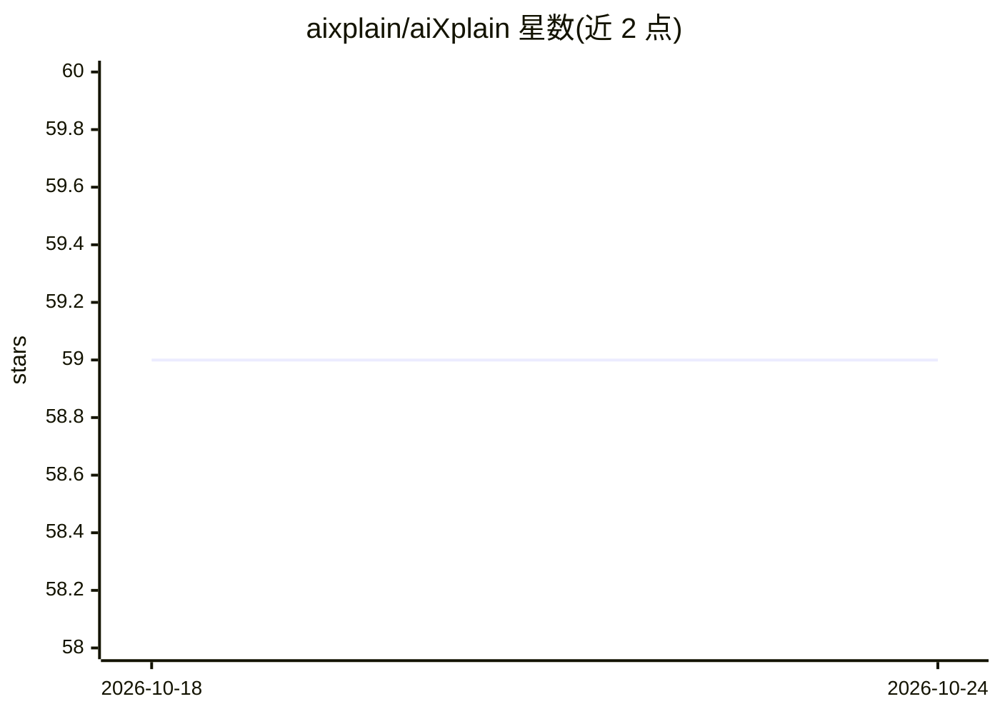

# aixplain/aiXplain

⭐ 59 · Python · Apache-2.0 · 推送 2026-10-23 · [GitHub](https://github.com/aixplain/aiXplain) · 组织维护

**Python SDK：将 AI agent 定义为代码并部署为 API**

面向 Python 开发者的 Agents SDK：用 Python 描述 agent 后调用 .save() 即部署为可通过 REST 调用的 API 端点，按使用量计费。平台提供 1,000+ 模型与工具接入（网页搜索、Slack、Gmail、MCP、自定义 Python 函数），单 API key 访问；支持云托管、本地部署与含隔离环境的 on-prem 三种方式。每次运行可设置成本/时长/迭代次数预算，Inspector 检查输入、中间步骤与结果，运行步骤与费用可在 dashboard 查看。另提供 Koder 自动构建部署 agent 及 Claude Code 插件。

## 筛选速览

| 维度 | 判定 | 备注 |
|---|---|---|
| AI 角色 | `ai-ecosystem` | LLM/agent 周边工具 |
| 许可风险 | `permissive` | Apache-2.0 |
| 部署形态 | `library` | 以包/库形式分发 |
| 模型依赖 | — | README 未给出锁定关系 |
| 硬件要求 | — | 无带数字的原话,不猜 |
| 安装摩擦 | `low` | 无编译、无系统依赖或容器化 |
| 成熟度 | — | 结构信号不足 |

## 能力要点

- Python 中 .save() 一行部署 agent 为 REST API
- 1,000+ 模型、工具与集成，单 API key 访问
- 按运行设置成本/时长/步数预算，Inspector 规则或 LLM judge 审查
- 支持云、on-prem（含 air-gapped）与本地三种部署方式

## 适用场景

- 把 AI agent 快速封装成可被任意语言调用的 API
- 控制 agent 每次运行的成本与执行步数
- 通过 Claude Code 插件或 Koder 辅助构建部署 agent

## 场景标签

`Agent 框架` `模型网关` · 领域:Agent 开发

## 证据(README 行号)

> L9:  Describe it in Python, call <code>.save()</code>, and it is live. You pay only when someone uses it.
> L44: - **Any model.** 1,000+ models, tools and integrations, one API key.

## 星数曲线

2026-10-18 59 → 2026-10-24 59（+0）

---
*卡片 v1 · prompt 1.4 · 生成 2026-10-24 · 置信度 high · 依据 README sha `bbec74c399a8` · [字段定义](../../DATASET.md)*
