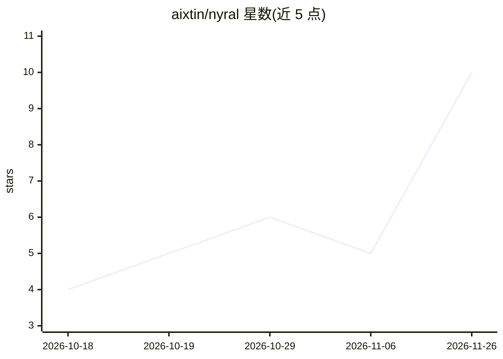

# aixtin/nyral

⭐ 10 · Kotlin · MIT · 推送 2026-11-21 · [GitHub](https://github.com/aixtin/nyral) · [官网](https://github.com/aixtin/nyral/releases/latest) · 个人维护 · 中文 README

**运行在 Android 手机上的开源个人 AI Agent，本地记忆+自带模型密钥**

一款面向 Android 的个人 Agent 应用：LLM 对话、端上长期记忆（bge-small ONNX 向量 + SQLite）、SSH 远程操作、Agent 自驱浏览器与语音/附件多模态集成在单一 App 中。推理不发生在手机端，需要用户自备任意 OpenAI 兼容端点的 Base URL + API Key；聊天、记忆与文件默认存于本地 SQLite，无账号、无遥测。内置 32 个工具（13 组能力），工具调用上限 40 轮，支持 MCP 客户端与服务端、危险操作二次确认与 SSRF 防护。安装靠 APK 或源码构建（JDK 17 + Android SDK）。

## 筛选速览

| 维度 | 判定 | 备注 |
|---|---|---|
| AI 角色 | `ai-native` | 本体是模型或模型工具 |
| 许可风险 | `permissive` | MIT |
| 部署形态 | `desktop` | 安装包/桌面程序 |
| 模型依赖 | — | README 未给出锁定关系 |
| 硬件要求 | — | 无带数字的原话,不猜 |
| 安装摩擦 | `medium` | 含编译或系统依赖之一 |
| 成熟度 | — | 结构信号不足 |

## 能力要点

- 端上长期记忆：bge-small ONNX 向量 + 关键词双路检索，SQLite 存储
- 32 个内置工具覆盖网络/SSH/浏览器/设备控制/定时任务
- MCP 双向：可接 Streamable HTTP MCP 服务器，自身也是只读 MCP 服务器
- 危险操作确认门、SSRF 校验、js_run 沙箱与危险命令拦截

## 适用场景

- 在手机上拥有一个带长期记忆的个人 AI 助手，数据不出设备
- 通过对话让 Agent 操作 SSH 远程主机和第三方 App
- 让 Agent 自主浏览网页、填表单并完成多步任务
- 用桌面 Agent 通过 MCP 查询手机状态与本地记忆

## 场景标签

`AI 助手` `Agent 记忆` `浏览器自动化` · 领域:Agent 开发

## 证据(README 行号)

> L14: ### An open-source personal agent that lives on your Android phone
> L37: > Nyral does not run a multi-GB LLM on your phone. Chats, memory and files stay in a local SQLite database; inferen
> L65: Nyral is an open-source personal agent for Android: LLM chat, long-term local memory, SSH remote operations, web to

## 星数曲线

2026-10-18 4 → 2026-11-26 10（+6）

---
*卡片 v1 · prompt 1.4 · 生成 2026-11-26 · 置信度 high · 依据 README sha `b27ea07d8dbe` · [字段定义](../../DATASET.md)*
