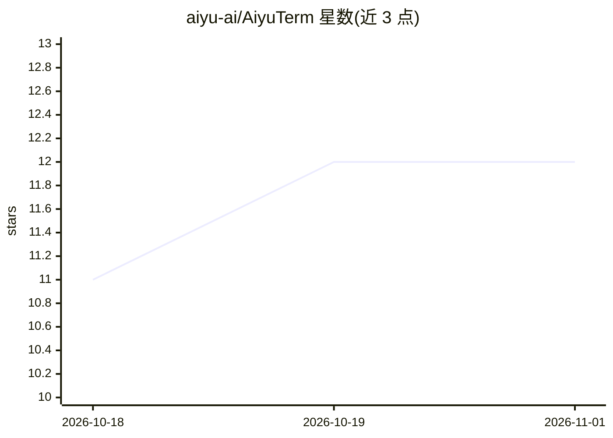

# aiyu-ai/AiyuTerm

⭐ 12 · Swift · Apache-2.0 · 推送 2026-04-14 · [GitHub](https://github.com/aiyu-ai/AiyuTerm) · [官网](https://github.com/aiyu-ai/AiyuTerm/releases/latest) · 组织维护 · 中文 README

**macOS 原生终端工作区，多仓库侧栏与 AI agent 实时状态**

面向跨多仓库/worktree/分屏工作的开发者的原生 macOS 终端应用，基于 Ghostty 终端引擎，用 AppKit+SwiftUI 构建。功能包括多仓库侧栏、按 worktree 保存的持久分屏布局、本地 shell/SSH/agent 会话混合、tmux 会话管理侧栏、命令面板与可自定义快捷键。AI 部分：为 Claude Code 提供实时权限/任务完成/错误状态徽标（基于 Claude Code hooks）。通过 GitHub Releases 提供签名 dmg，数据本地存储、无云同步。要求 macOS 14.6+，Universal 构建。

## 筛选速览

| 维度 | 判定 | 备注 |
|---|---|---|
| AI 角色 | `ai-enhanced` | 去掉 AI 部分产品仍成立 |
| 许可风险 | `permissive` | Apache-2.0 |
| 部署形态 | `desktop` | 安装包/桌面程序 |
| 模型依赖 | — | README 未给出锁定关系 |
| 硬件要求 | — | 无带数字的原话,不猜 |
| 安装摩擦 | `low` | 无编译、无系统依赖或容器化 |
| 成熟度 | — | 结构信号不足 |

## 能力要点

- 多仓库与 worktree 侧栏，布局按 worktree 持久保存
- 本地 shell/SSH/tmux/agent 会话混合工作区
- Claude Code 实时状态徽标（权限/完成/错误，基于 hooks）
- 基于 Ghostty 引擎的原生 AppKit+SwiftUI 应用

## 适用场景

- 同时开发多个仓库或 worktree，快速切换并恢复分屏布局
- 在同一工作区管理 SSH 连接与 tmux 会话
- 运行 Claude Code 时通过侧栏徽标获知何时需要授权或任务完成

## 场景标签

 · 领域:开发者工具/终端

## 证据(README 行号)

> L8: AiyuTerm is a native macOS terminal workspace app for developers who work across repositories, worktrees, branches, 
> L21: - **Agent status badges** -- Real-time permission and task completion notifications for Claude Code
> L99: AiyuTerm shows real-time status on sidebar icons when Claude Code needs attention:

## 星数曲线

2026-10-18 11 → 2026-11-01 12（+1）

---
*卡片 v1 · prompt 1.4 · 生成 2026-11-01 · 置信度 high · 依据 README sha `8ed72249815e` · [字段定义](../../DATASET.md)*
