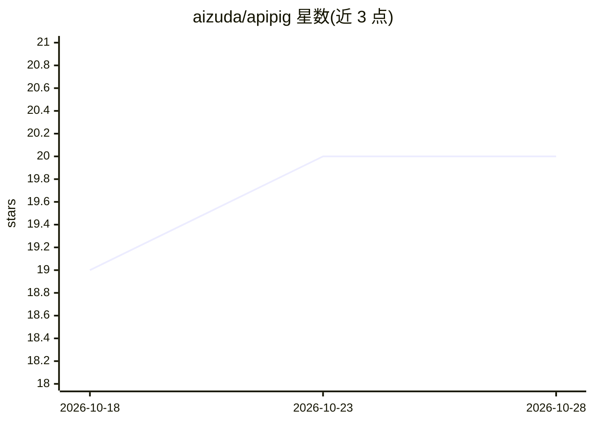

# aizuda/apipig

⭐ 20 · Vue · AGPL-3.0 · 推送 2026-09-12 · [GitHub](https://github.com/aizuda/apipig) · [官网](https://apipig.aizuda.com/) · 组织维护 · 中文 README

**面向企业的免费 AI 网关：多模型统一接入与调用治理**

Go 编写的 AI 网关与控制台，把多模型接入、账号池、API Key 托管、路由策略、权限控制、限流熔断与调用审计收进同一平台。对外提供 OpenAI 与 Anthropic 双兼容协议（聊天、嵌入、图片生成、rerank、语音合成/识别），上游适配 OpenAI/Anthropic/xAI/Gemini/Qwen/Ollama 等。业务系统只对接一个入口，上游切换与安全治理在平台侧完成。附带 Git WebHook AI 代码评审与微美元计费账本，采用 AGPL-3.0 开源并存在企业版演示入口。

## 筛选速览

| 维度 | 判定 | 备注 |
|---|---|---|
| AI 角色 | `ai-ecosystem` | LLM/agent 周边工具 |
| 许可风险 | `viral` | AGPL-3.0 |
| 部署形态 | `desktop` | 安装包/桌面程序 |
| 模型依赖 | locked-api |  |
| 硬件要求 | — | 无带数字的原话,不猜 |
| 安装摩擦 | `low` | 无编译、无系统依赖或容器化 |
| 成熟度 | — | 结构信号不足 |

## 能力要点

- OpenAI 与 Anthropic 双兼容协议入口（含 Claude Code 直接接入）
- 供应商/渠道/Token 管理、限流熔断、失败回退与调用审计留痕
- Token 与渠道密钥 AES-256-GCM 加密存储、仅保存哈希
- 微美元整数计费账本，支持缓存读写与渠道成本倍率

## 适用场景

- 企业内部统一收口多家模型 API，业务只维护一个网关入口
- 集中托管 API Key 与渠道配置并做调用审计与合规复核
- 通过 Git WebHook 触发 AI 代码评审

## 场景标签

`模型网关` `代码审查` · 领域:Agent 开发

## 证据(README 行号)

> L7: > APIPIG 把多模型接入、账号池、API Key 托管、路由策略、权限控制和调用审计收进同一套 AI 网关与控制台。业务系统只对接一个入口，上游模型切换、渠道调整和安全治理都在平台侧完成。
> L9: - 统一 OpenAI 兼容协议入口
> L99: - 支持双协议接入

## 星数曲线

2026-10-18 19 → 2026-10-28 20（+1）

---
*卡片 v1 · prompt 1.4 · 生成 2026-10-28 · 置信度 high · 依据 README sha `f444669edef6` · [字段定义](../../DATASET.md)*
