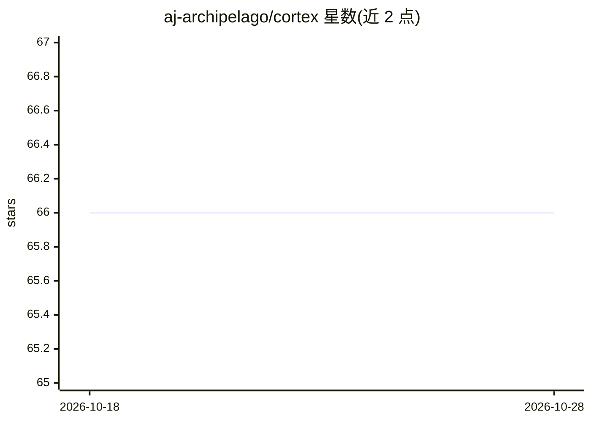

# aj-archipelago/cortex

⭐ 66 · JavaScript · MIT · 推送 2026-09-24 · [GitHub](https://github.com/aj-archipelago/cortex) · [官网](https://www.npmjs.com/package/@aj-archipelago/cortex) · 个人维护

**开源 AI 后端控制平面：多模型路由、agent 工具与私有工作区**

面向构建 AI 产品的团队的后端运行时：将 OpenAI、Azure OpenAI、Gemini、Claude/Vertex、Grok、Replicate、Ollama 及本地模型等统一到 GraphQL、REST、OpenAI 兼容与 Anthropic 风格 API 之后，提供模型分组、重定向、延迟采样与健康端点选择的路由；内置 sys_entity_agent 运行时支持工具发现（含 MCP）、流式进度与结果压缩；可为每个实体配备 Docker 或 Azure Container Instances 隔离工作区，含 shell、文件 API、checkpoint/restore 与空闲回收。以 npm 包或源码运行，需 Node.js 20+，REST 默认关闭需环境变量开启。

## 筛选速览

| 维度 | 判定 | 备注 |
|---|---|---|
| AI 角色 | `ai-ecosystem` | LLM/agent 周边工具 |
| 许可风险 | `permissive` | MIT |
| 部署形态 | `library` | 以包/库形式分发 |
| 模型依赖 | local-ok | 支持本地模型 |
| 硬件要求 | — | 无带数字的原话,不猜 |
| 安装摩擦 | `low` | 无编译、无系统依赖或容器化 |
| 成熟度 | — | 结构信号不足 |

## 能力要点

- 多 provider 模型路由，暴露 GraphQL/REST/OpenAI 兼容/Anthropic 风格 API
- sys_entity_agent：工具发现（含 MCP 热加载）、客户端工具回调、流式进度与结果压缩
- 实体私有容器工作区：Docker/ACI、shell、文件 API、checkpoint/restore、空闲回收
- npm 包或 git clone 源码两种安装方式

## 适用场景

- 用统一内部 AI API 替代散落在代码中的各 provider SDK
- 构建带工具调用与私有沙箱的 agent 应用
- 模型升级或切换 provider 而不改客户端代码

## 场景标签

`模型网关` `Agent 框架` · 领域:Agent 开发

## 证据(README 行号)

> L9: Cortex is an open-source AI backend control plane: model routing, agent tools, OpenAI-compatible APIs, and private w
> L17: - **One API for many providers.** Route OpenAI, Azure OpenAI, Gemini, Claude on Vertex, Grok, Replicate-hosted medi
> L44: |Provider SDKs|Direct access to one provider's newest API|Cortex keeps product code behind a stable runtime while p

## 星数曲线

2026-10-18 66 → 2026-10-28 66（+0）

---
*卡片 v1 · prompt 1.4 · 生成 2026-10-24 · 置信度 high · 依据 README sha `2e3e8aa8f311` · [字段定义](../../DATASET.md)*
