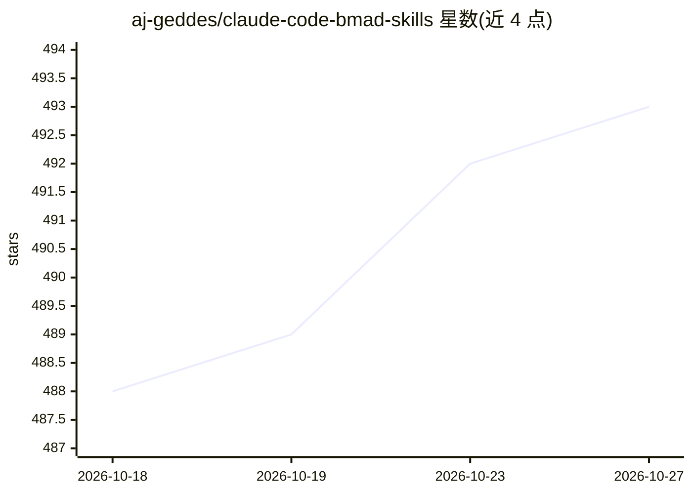

# aj-geddes/claude-code-bmad-skills

⭐ 493 · Shell · NOASSERTION · 推送 2026-06-20 · [GitHub](https://github.com/aj-geddes/claude-code-bmad-skills) · 个人维护

**把 BMAD 敏捷方法接入 Claude Code 的规划编排插件**

一个 Claude Code 插件市场仓库，内置单一插件 BMAD Planning & Orchestrator：以 BMAD Method 驱动软件工作的分析、规划、方案设计与实现交接，按 Quick Flow / BMad Method / Enterprise 三档轨道调整流程，产出 ready-for-dev 故事文件与工具无关的 handoff-manifest.json。定位是规划与编排而非写代码；通过一套架构约束与按不相交文件划分的并行波次减少多 agent 冲突。开发者代码/lint/coverage 部分已在 v6.x 转向后移除。

## 筛选速览

| 维度 | 判定 | 备注 |
|---|---|---|
| AI 角色 | `ai-ecosystem` | LLM/agent 周边工具 |
| 许可风险 | `permissive` | NOASSERTION |
| 部署形态 | `None` |  |
| 模型依赖 | — | README 未给出锁定关系 |
| 硬件要求 | — | 无带数字的原话,不猜 |
| 安装摩擦 | `low` | 无编译、无系统依赖或容器化 |
| 成熟度 | — | 结构信号不足 |

## 能力要点

- 运行 BMAD 生命周期：Analysis → Planning → Solutioning → Implementation-handoff
- 产出 ready-for-dev 故事文件与工具无关的 handoff-manifest.json
- 按不相交文件划分依赖有序的并行波次以避免文件/合并冲突
- 通过 Claude Code 插件市场安装，随市场更新

## 适用场景

- 在 Claude Code 中按 BMAD 方法规划多 agent 并行开发任务
- 为开发工具生成交接清单与故事文件
- 以不同重量级流程（Quick Flow 到 Enterprise）组织软件规划

## 场景标签

`多智能体` · 领域:Agent 开发

## 证据(README 行号)

> L7: > This repository is a **Claude Code plugin marketplace**. It ships one plugin —
> L12: > **It plans and orchestrates. It does not write the code.**
> L47: The plugin runs the BMAD lifecycle — **Analysis → Planning → Solutioning →

## 星数曲线

2026-10-18 488 → 2026-10-27 493（+5）

---
*卡片 v1 · prompt 1.4 · 生成 2026-10-23 · 置信度 high · 依据 README sha `78d01ee50e08` · [字段定义](../../DATASET.md)*
