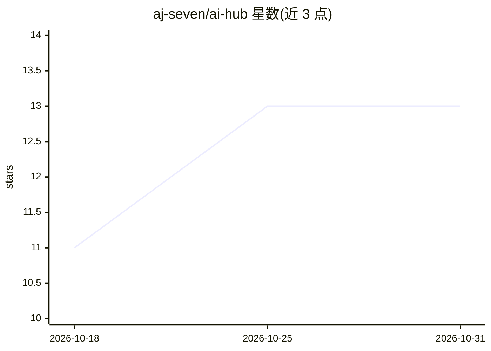

# aj-seven/ai-hub

⭐ 13 · TypeScript · MIT · 推送 2026-08-10 · [GitHub](https://github.com/aj-seven/ai-hub) · [官网](https://ai-hubx.vercel.app) · 个人维护

**面向用户的多模型聊天与内容生成 Web/桌面应用**

基于 Next.js/TypeScript/Tauri 的多模型 AI 助手应用，供终端用户与 GPT、Claude、Gemini 及本地 Ollama（LLaMA）模型对话，并提供邮件生成、推文生成、SEO 博客草稿、语法修正等内容创作功能。支持在本地与云端模型间切换，API key 仅存储于浏览器本地。提供浏览器访问的开发部署方式（git clone + 包管理器安装依赖）与 Tauri 桌面构建（从 GitHub Releases 下载），桌面版集成 Ollama 并规避 CORS 问题。

## 筛选速览

| 维度 | 判定 | 备注 |
|---|---|---|
| AI 角色 | `ai-native` | 本体是模型或模型工具 |
| 许可风险 | `permissive` | MIT |
| 部署形态 | `library` | 以包/库形式分发 |
| 模型依赖 | local-ok | 支持本地模型 |
| 硬件要求 | — | 无带数字的原话,不猜 |
| 安装摩擦 | `low` | 无编译、无系统依赖或容器化 |
| 成熟度 | — | 结构信号不足 |

## 能力要点

- 与 GPT/Claude/Gemini/Ollama 多模型对话与提示词测试场
- 邮件/推文/博客等内容生成工具，含语气控制
- Tauri 原生桌面应用，简化 Ollama 接入并规避 CORS
- API key 仅存储在浏览器本地

## 适用场景

- 在一个界面里切换使用多家云端与本地模型聊天
- 快速生成邮件、推文和博客草稿等日常内容
- 在不同 LLM 之间对比测试提示词效果

## 场景标签

`AI 助手` `提示工程` · 领域:Agent 开发

## 证据(README 行号)

> L14: - **Chat Interface** — Converse with GPT, Claude, LLaMA (Ollama), Gemini.
> L15: - **Email Generator** — Generate professional or casual emails with tone control.
> L20: - **Multi-model Support** — Switch between local (Ollama) & cloud models.

## 星数曲线

2026-10-18 11 → 2026-10-31 13（+2）

---
*卡片 v1 · prompt 1.4 · 生成 2026-10-31 · 置信度 mid · 依据 README sha `76ceed3be462` · [字段定义](../../DATASET.md)*
