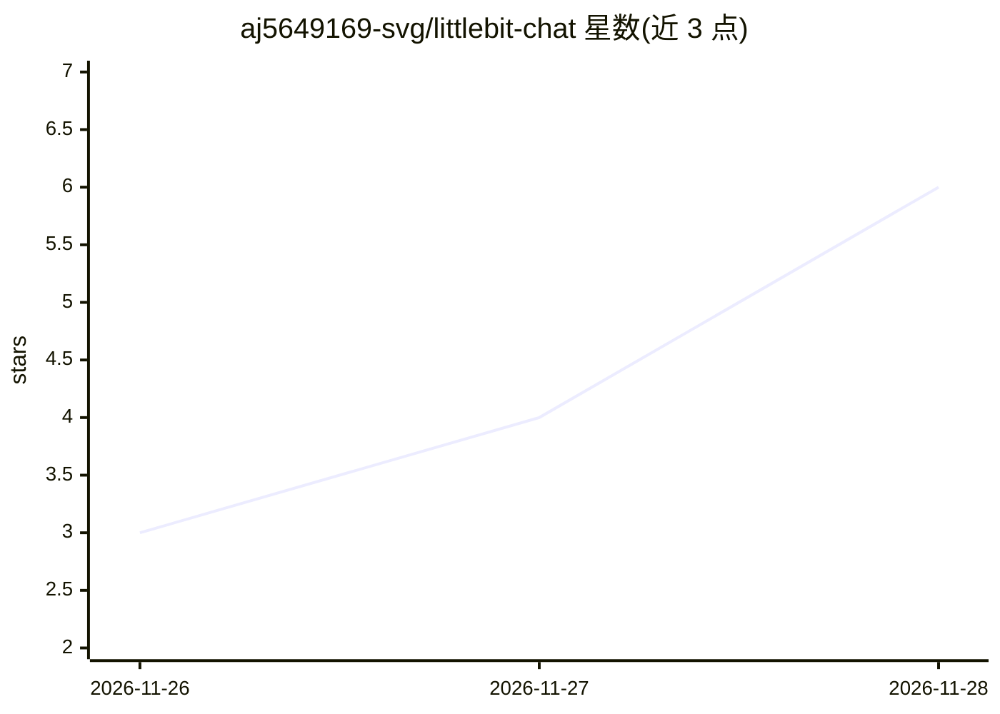

# aj5649169-svg/littlebit-chat

⭐ 6 · Kotlin · MIT · 推送 2026-11-27 · [GitHub](https://github.com/aj5649169-svg/littlebit-chat) · 个人维护

**100% 离线的 Android 本地 LLM 聊天应用，无网络权限**

基于 llama.cpp 的 Android ARM64 本地大模型聊天应用，默认 Vulkan GPU 卸载，GPU 初始化失败时回退到 Arm KleidiAI CPU 推理；应用无互联网权限，模型权重由用户自行加载 GGUF 文件。支持 Fast/Think 两种模式、流式输出、Markdown 与 LaTeX 渲染、对话搜索/导出、本地模板与计算工具，并提供 Quick Benchmark 在不同后端间对比性能。发布签名 APK，亦可从源码构建。

## 筛选速览

| 维度 | 判定 | 备注 |
|---|---|---|
| AI 角色 | `ai-native` | 本体是模型或模型工具 |
| 许可风险 | `permissive` | MIT |
| 部署形态 | `None` |  |
| 模型依赖 | local-ok | 支持本地模型 |
| 硬件要求 | — | 无带数字的原话,不猜 |
| 安装摩擦 | `low` | 无编译、无系统依赖或容器化 |
| 成熟度 | — | 结构信号不足 |

## 能力要点

- 默认 Vulkan 卸载，失败回退 Arm KleidiAI CPU 推理
- 零互联网权限，推理可在飞行模式下运行
- KV 前缀复用与 Flash Attention（Q8_0 KV，回退 F16）
- 按手机内存分档推荐 Qwen3/Llama 3.2 模型

## 适用场景

- 在手机上离线运行本地 GGUF 模型聊天
- 不想对话数据上传云端的隐私场景
- 对比 Vulkan GPU 与 CPU 推理在设备上的速度

## 场景标签

`聊天机器人` · 领域:对话与助手

## 证据(README 行号)

> L3: 100% offline, private, Vulkan-accelerated AI chat for Android. No cloud, accounts or telemetry. Bring a GGUF model a
> L30: - **Local engine.** Patched llama.cpp defaults to Vulkan offload and falls back to Arm KleidiAI CPU inference if GP

## 星数曲线

2026-11-26 3 → 2026-11-28 6（+3）

---
*卡片 v1 · prompt 1.4 · 生成 2026-11-26 · 置信度 high · 依据 README sha `dc5d0c4dfe34` · [字段定义](../../DATASET.md)*
