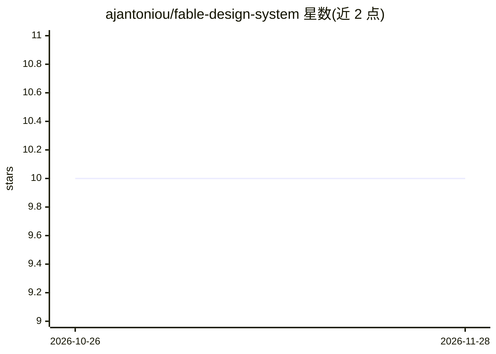

# ajantoniou/fable-design-system

⭐ 10 · HTML · NOASSERTION · 推送 2026-07-02 · [GitHub](https://github.com/ajantoniou/fable-design-system) · [官网](https://www.uploadcheck.app) · 个人维护

**给 AI 编码 agent 安装的 Fable 风格设计系统技能包**

一份 MIT 许可的设计系统技能包：由 persona 规范、证据文档与分工具 skill 文件组成，安装到 Claude Code、Codex、Antigravity/Gemini、Cursor 等 AI 编码 agent 后，使 agent 在生成 UI 时先声明设计系统（色板、字体、间距、动效、无障碍），采用 clamp() 流式字号、单一强调色、克制动效，并通过测量对比度与真实浏览器断点自检。自称从公开模型输出的设计推理重建的风格，不含模型权重或提示词。通过一条 curl 脚本或各工具手动复制文件安装。

## 筛选速览

| 维度 | 判定 | 备注 |
|---|---|---|
| AI 角色 | `ai-enhanced` | 去掉 AI 部分产品仍成立 |
| 许可风险 | `permissive` | NOASSERTION |
| 部署形态 | `None` |  |
| 模型依赖 | — | README 未给出锁定关系 |
| 硬件要求 | — | 无带数字的原话,不猜 |
| 安装摩擦 | `low` | 无编译、无系统依赖或容器化 |
| 成熟度 | — | 结构信号不足 |

## 能力要点

- 提供分工具 SKILL.md（Claude/Codex/Antigravity）与 .cursor/rules 规则文件
- 一条 curl 脚本自动检测已装 agent 并安装，带备份且无需 sudo
- 内置通过测量对比度与断点自检的设计工作流
- 声明不含模型权重、提示词或专有材料，仅为观察归纳的设计指引

## 适用场景

- 让 Claude Code/Cursor 生成落地页与定价区块时有成体系的设计输出
- 不请设计师的情况下用 AI agent 建站并保证 UI 质量
- 在团队项目中通过 CLAUDE.md/AGENTS.md 强制统一设计规范

## 场景标签

`提示工程` · 领域:Agent 开发

## 证据(README 行号)

> L39: **Fable Design Skill** reconstructs that design instinct as a portable skill you
> L45: It's not a UI kit or a component library. It's a **design brain** — a set of

## 星数曲线

2026-10-26 10 → 2026-11-28 10（+0）

---
*卡片 v1 · prompt 1.4 · 生成 2026-11-20 · 置信度 mid · 依据 README sha `a4181ea71d86` · [字段定义](../../DATASET.md)*
