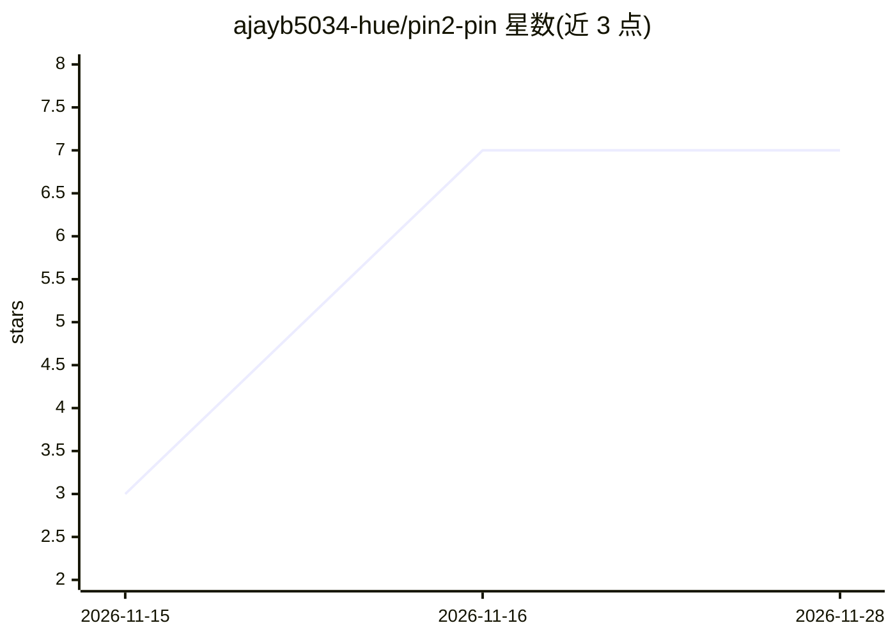

# ajayb5034-hue/pin2-pin

⭐ 7 · Python · MIT · 推送 2026-11-26 · [GitHub](https://github.com/ajayb5034-hue/pin2-pin) · [官网](https://preemptionsoftwares.antideploy.app/) · 个人维护

**本地优先的 AI 运营看板：组建专家 agent 团队并管理任务**

运行于本机的 FastAPI 应用，使用本地 SQLite 数据库。用户创建公司档案、配置自定义专家 agent（可编辑职务与指令）、安排每日/每周周期任务，任务在看板上逐项派发，外部动作（如发邮件、发布 Telegram 帖子）需所有者批准。提示词仅发送到用户配置的模型服务商，API 密钥本地存储于 .env。限制：仅支持 Windows 安装脚本、单用户无登录、仅绑定 loopback，云服务商按其条款处理发送内容。

## 筛选速览

| 维度 | 判定 | 备注 |
|---|---|---|
| AI 角色 | `ai-native` | 本体是模型或模型工具 |
| 许可风险 | `permissive` | MIT |
| 部署形态 | `desktop` | 安装包/桌面程序 |
| 模型依赖 | locked-api |  |
| 硬件要求 | — | 无带数字的原话,不猜 |
| 安装摩擦 | `low` | 无编译、无系统依赖或容器化 |
| 成熟度 | — | 结构信号不足 |

## 能力要点

- 本地优先：FastAPI + 本地 SQLite，数据保留在 backend/ 下
- 自定义专家 agent 与每日/每周周期调度
- 外部动作（邮件、Telegram）需所有者逐项批准
- 媒体生成可选 Gemini 或 deAPI.ai，产物本地保存

## 适用场景

- 在本机搭建一套按计划自动运行的专家 agent 团队
- 通过任务看板追踪、审批和复盘 agent 交付物
- 集中管理多家模型服务商的 API 密钥与调用

## 场景标签

`模型网关` `工作流自动化` · 领域:Agent 开发

## 证据(README 行号)

> L5: Pin2Pin is a local-first AI operations dashboard. Create a company profile, assign work
> L23: - Uses real configured model providers; it does not simulate model results.

## 星数曲线

2026-11-15 3 → 2026-11-28 7（+4）

---
*卡片 v1 · prompt 1.4 · 生成 2026-11-20 · 置信度 high · 依据 README sha `06e438cce7ae` · [字段定义](../../DATASET.md)*
