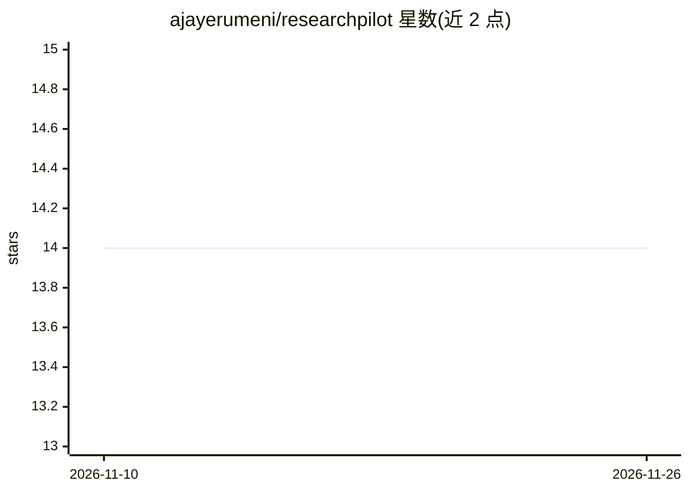

# ajayerumeni/researchpilot

⭐ 14 · TypeScript · MIT · 推送 2026-11-09 · [GitHub](https://github.com/ajayerumeni/researchpilot) · [官网](https://researchpilot-gamma.vercel.app) · 个人维护

**面向研究者的 AI 深度研究 agent：输入问题输出带引用报告**

基于 Next.js 与 Vercel AI SDK 的深度研究应用：用户输入一个问题，系统由规划 LLM 分解为 2-5 个研究方面，并行执行 Firecrawl + Tavily 搜索，对每个来源做可信度评分，用 LLM 检测跨来源矛盾，按信息增益自适应加深或提前停止，最终组装带行内引用的结构化报告。用户不配置广度深度，仅选择 Quick/Thorough/Deep 三档。运行需 Bun v1.2+、Firecrawl API key 及 OpenRouter/OpenAI/Groq 之一的服务商密钥。MIT 许可，自托管。

## 筛选速览

| 维度 | 判定 | 备注 |
|---|---|---|
| AI 角色 | `ai-native` | 本体是模型或模型工具 |
| 许可风险 | `permissive` | MIT |
| 部署形态 | `None` |  |
| 模型依赖 | locked-api |  |
| 硬件要求 | — | 无带数字的原话,不猜 |
| 安装摩擦 | `low` | 无编译、无系统依赖或容器化 |
| 成熟度 | — | 结构信号不足 |

## 能力要点

- 规划-搜索-抽取-评估-报告的八步研究流水线
- 来源可信度评分（域启发式 + LLM 评估）与 LLM 矛盾检测
- 分层模型调度：fast/smart/strategic 三档降低调用成本
- 通过 AbortSignal 传播实现客户端断开即中止在途调用

## 适用场景

- 输入研究主题生成带引用的结构化报告
- 对事实性查询做快速核查（Quick 档 30-60 秒）
- 多方面复杂问题的深度分析（Deep 档 5-10 分钟）

## 场景标签

`科研工具` · 领域:学习与行业

## 证据(README 行号)

> L16: You type a question. ResearchPilot builds a research plan, executes dozens of targeted web searches in parallel, sc
> L26: 1. **Plan** — A strategic LLM decomposes your query into 2-5 research aspects with sub-questions and priorities

## 星数曲线

2026-11-10 14 → 2026-11-26 14（+0）

---
*卡片 v1 · prompt 1.4 · 生成 2026-11-18 · 置信度 high · 依据 README sha `fb717914f760` · [字段定义](../../DATASET.md)*
