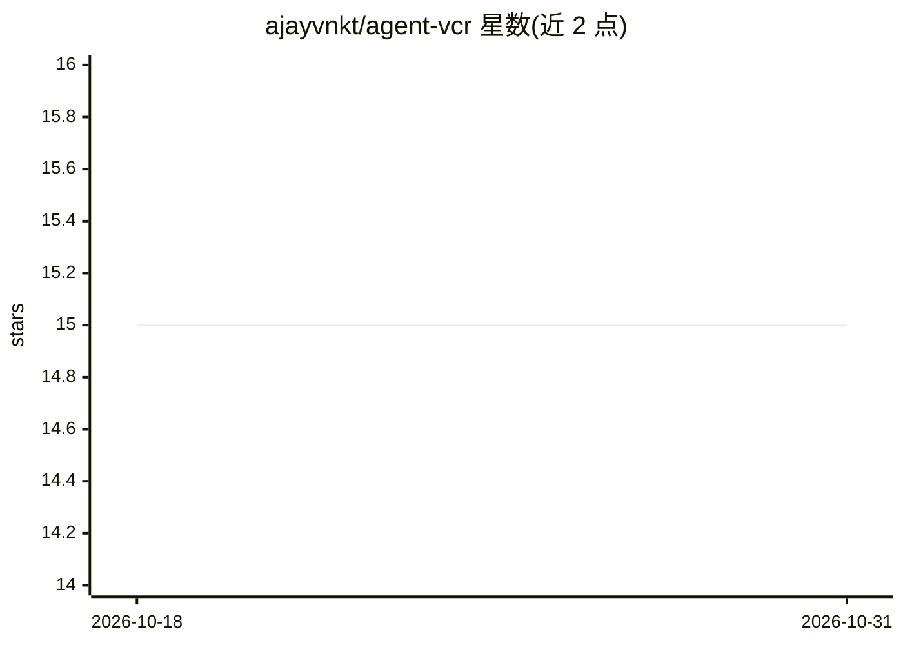

# ajayvnkt/agent-vcr

⭐ 15 · TypeScript · MIT · 推送 2026-10-26 · [GitHub](https://github.com/ajayvnkt/agent-vcr) · [官网](https://www.npmjs.com/package/agent-vcr) · 个人维护

**LLM 工具调用的快照测试库：录制一次，CI 回放零 API 成本**

面向 LLM agent 开发者的 TypeScript/Node 测试库：用真实 LLM 录制工具调用序列生成 golden trace 提交 git，CI 中确定性回放，序列漂移即构建失败，无需 API key 与模型调用。核心机制包括 record.config.json 录制、ScriptedLlm 回放、四级可靠性套件（策略断言/多变体/多轮/gated judge）、compaction 稳定性与 token 归因分析。提供 OpenAI、Anthropic、Vercel AI、LangChain 的 SDK 适配器与 CLI。限制：不测试模型质量；录制阶段仍调用真实 API。

## 筛选速览

| 维度 | 判定 | 备注 |
|---|---|---|
| AI 角色 | `ai-ecosystem` | LLM/agent 周边工具 |
| 许可风险 | `permissive` | MIT |
| 部署形态 | `library` | 以包/库形式分发 |
| 模型依赖 | local-ok | 支持本地模型 |
| 硬件要求 | — | 无带数字的原话,不猜 |
| 安装摩擦 | `low` | 无编译、无系统依赖或容器化 |
| 成熟度 | `idea` | |

## 能力要点

- 真实 LLM 录制 → golden trace → CI 零 API 成本确定性回放
- 四级可靠性套件：策略断言、多变体路径、多轮场景、门控 LLM judge
- requires/ordering 政策断言：检测 refund 前未 verify 的序列违规
- compaction 一等公民事件与稳定性方差（双峰）分析

## 适用场景

- prompt 改动后在 CI 拦截工具调用序列回归
- 为高风险工具链（转账/退款）固化调用顺序与参数校验
- 长会话 agent 的 compaction 稳定性与多轮场景测试

## 场景标签

`模型评测` · 领域:评测与运维

## 证据(README 行号)

> L43: Agent VCR fixes this. It's **VCR for your tool calls** — the same idea as HTTP cassette recording, applied to `tool
> L61: > **What it tests:** Tool dispatch logic, routing graphs, arg shapes, guard rails.
> L249: The agent is injected. agent-vcr doesn't want to own your framework — you bring something that answers a user mess

## 星数曲线

2026-10-18 15 → 2026-10-31 15（+0）

---
*卡片 v1 · prompt 1.4 · 生成 2026-10-30 · 置信度 high · 依据 README sha `53b2c3010044` · [字段定义](../../DATASET.md)*
