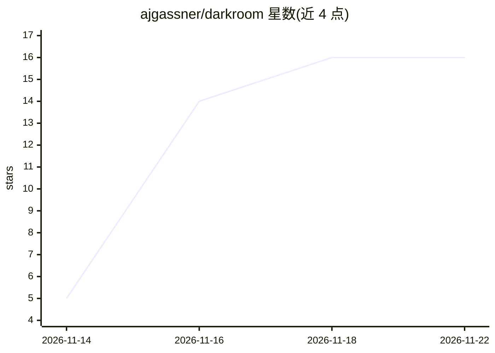

# ajgassner/darkroom

⭐ 16 · TypeScript · MIT · 推送 2026-11-13 · [GitHub](https://github.com/ajgassner/darkroom) · 个人维护

**本地自托管 AI 创作工作室：图像、克隆语音与音乐生成**

基于 React/TypeScript 的自托管 Web 应用加 CLI，通过 OpenRouter API 生成图像、语音与音乐：上传参考照片建立可复用 Elements（人物/Logo/产品等），用 @提及在提示词中引用；同一提示词可并行发给多个模型对比；支持克隆语音（Fish Audio/Seed Audio/HeyGen）、39 个 TTS 模型与 Google Lyria 音乐；提供放大、扩画布、重打光等 AI 图像工具与本地免费工具。默认仅调用零数据保留端点，需自备 OpenRouter API key，按用量付费。

## 筛选速览

| 维度 | 判定 | 备注 |
|---|---|---|
| AI 角色 | `ai-native` | 本体是模型或模型工具 |
| 许可风险 | `permissive` | MIT |
| 部署形态 | `library` | 以包/库形式分发 |
| 模型依赖 | locked-api |  |
| 硬件要求 | — | 无带数字的原话,不猜 |
| 安装摩擦 | `low` | 无编译、无系统依赖或容器化 |
| 成熟度 | — | 结构信号不足 |

## 能力要点

- 同一提示词并行发送多个模型对比生成
- Elements 参考集（人物/Logo/产品/场景/风格）以 @提及嵌入提示词
- 语音克隆（10-30 秒样本）+ 39 个 TTS 模型 + Google Lyria 音乐
- 默认走零数据保留端点，结果附带完整请求/响应与成本清单

## 适用场景

- 用自己的照片生成人物/品牌图像，多模型并排对比选效果
- 用自己的声音样本克隆语音并合成朗读
- 本地生成与编辑图像，不上传数据到第三方存储

## 场景标签

`图像生成` `语音合成` · 领域:内容生成

## 证据(README 行号)

> L7: A self-hosted alternative to getimg.ai and similar subscription services. Upload a few photos of a person, a logo or
> L26: - **Audio**: text-to-speech with 39 models, cloned voices from your own samples, and music with Google Lyria.

## 星数曲线

2026-11-14 5 → 2026-11-22 16（+11）

---
*卡片 v1 · prompt 1.4 · 生成 2026-11-18 · 置信度 mid · 依据 README sha `ae9059281825` · [字段定义](../../DATASET.md)*
