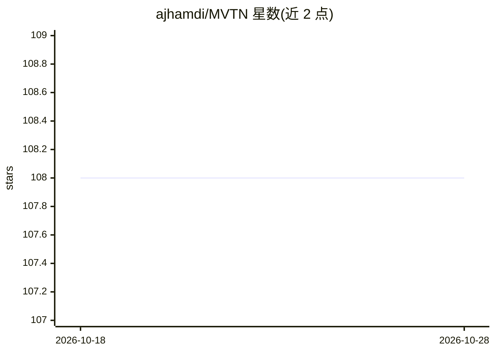

# ajhamdi/MVTN

⭐ 108 · Python · 推送 2025-12-15 · [GitHub](https://github.com/ajhamdi/MVTN) · 个人维护

**ICCV'21 论文 MVTN 的 PyTorch 实现：3D 形状识别多视角变换网络**

论文官方 PyTorch 代码（ICCV 2021）。MVTN 学习变换 3D 物体的渲染参数，改进多视角网络的识别视角，在无额外监督或损失的情况下用于 3D 分类与形状检索任务，在 ModelNet40、ShapeNet Core55、ScanObjectNN 数据集上报告结果。主入口 run_mvtn.py 支持 train/test_cls/test_retr 等运行模式，可选 mvcnn/rotnet/viewgcn 多视角网络与六种视角配置，支持点云与网格渲染。安装经 conda 或 venv+pip，需另行安装 PyTorch 与 PyTorch3D，MIT 许可。

## 筛选速览

| 维度 | 判定 | 备注 |
|---|---|---|
| AI 角色 | `ai-native` | 本体是模型或模型工具 |
| 许可风险 | `none` | — |
| 部署形态 | `library` | 以包/库形式分发 |
| 模型依赖 | — | README 未给出锁定关系 |
| 硬件要求 | — | 无带数字的原话,不猜 |
| 安装摩擦 | `medium` | 含编译或系统依赖之一 |
| 成熟度 | — | 结构信号不足 |

## 能力要点

- 学习式渲染参数变换，无需额外监督或损失
- 支持 ModelNet40 / ShapeNet Core55 / ScanObjectNN 三个数据集
- 可选 MVCNN、RotNet、ViewGCN 作为多视角网络
- 含可微 PyTorch3D 渲染器，支持点云与网格渲染

## 适用场景

- 复现论文中的 3D 分类与形状检索实验
- 用 MVTN 类与其他管线集成做 3D 形状识别
- 研究多视角渲染参数对识别的影响

## 场景标签

`模型训练` · 领域:训练与推理

## 证据(README 行号)

> L10: The official Pytroch code of ICCV 2021 paper MVTN: Multi-View Transformation Network for 3D Shape Recognition. MVTN
> L71: python run_mvtn.py --data_dir data/ModelNet40/ --run_mode train --mvnetwork mvcnn --nb_views 8 --views_config learn

## 星数曲线

2026-10-18 108 → 2026-10-28 108（+0）

---
*卡片 v1 · prompt 1.4 · 生成 2026-10-23 · 置信度 high · 依据 README sha `a4e4f4a68c7b` · [字段定义](../../DATASET.md)*
