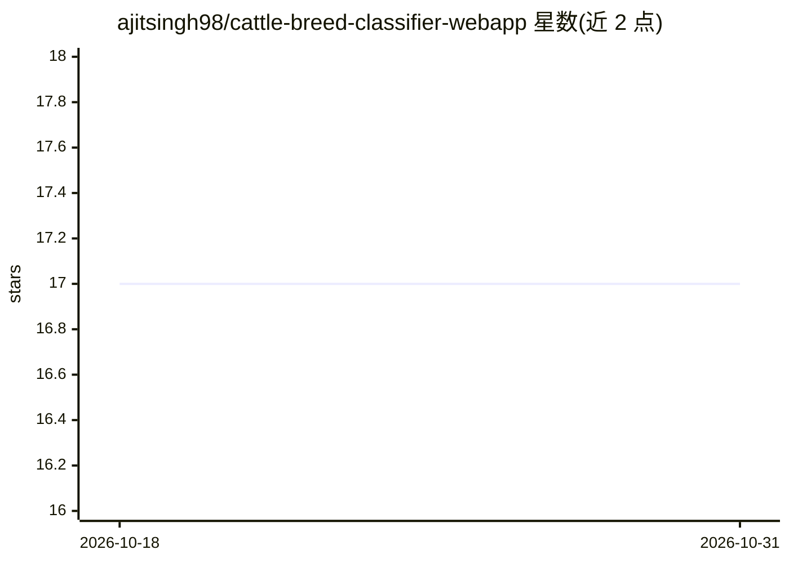

# ajitsingh98/cattle-breed-classifier-webapp

⭐ 17 · Jupyter Notebook · MIT · 推送 2026-08-02 · [GitHub](https://github.com/ajitsingh98/cattle-breed-classifier-webapp) · [官网](https://huggingface.co/spaces/sajit9285/cattle-breed-classifier) · 个人维护

**从图片识别 26 种印度本土牛与水牛品种的深度学习应用**

端到端深度学习项目：用 PyTorch/fastAI 训练并对比 4 种图像分类架构（MLP、自建 CNN、ResNet-50 迁移学习、ViT-B/16），识别 21 种奶牛与 5 种水牛品种，最优准确率约 63.2%。提供 FastAPI 后端捆绑 React 静态文件的统一 Docker 部署，以及 Hugging Face Spaces 在线演示；另附 Google Colab notebook 供用 T4 GPU 复现训练。限制：识别范围限于 26 个印度本土品种，最高准确率 63.2%。

## 筛选速览

| 维度 | 判定 | 备注 |
|---|---|---|
| AI 角色 | `ai-native` | 本体是模型或模型工具 |
| 许可风险 | `permissive` | MIT |
| 部署形态 | `self-host` | docker 或自建部署 |
| 模型依赖 | — | README 未给出锁定关系 |
| 硬件要求 | — | 无带数字的原话,不猜 |
| 安装摩擦 | `low` | 无编译、无系统依赖或容器化 |
| 成熟度 | — | 结构信号不足 |

## 能力要点

- 对比 4 种架构（MLP/CNN/ResNet-50/ViT-B/16）并给出基准表
- 识别 26 种印度本土牛与水牛品种（21 奶牛 + 5 水牛）
- FastAPI 统一服务器捆绑 React 前端，Docker 容器化部署
- 提供 Colab notebook 自动复现全部训练流程

## 适用场景

- 上传照片识别印度本土牛或水牛品种
- 在 Colab 上用免费 T4 GPU 复现模型训练
- 参考多架构对比的图像分类训练流水线

## 场景标签

`目标检测` `模型训练` · 领域:感知与多模态

## 证据(README 行号)

> L12: This project solves this by delivering an end-to-end deep learning pipeline and an accessible web application capab
> L17: **Test the fully deployed Vision Transformer natively in the browser here:**

## 星数曲线

2026-10-18 17 → 2026-10-31 17（+0）

---
*卡片 v1 · prompt 1.4 · 生成 2026-10-29 · 置信度 high · 依据 README sha `c3ae7934ff90` · [字段定义](../../DATASET.md)*
